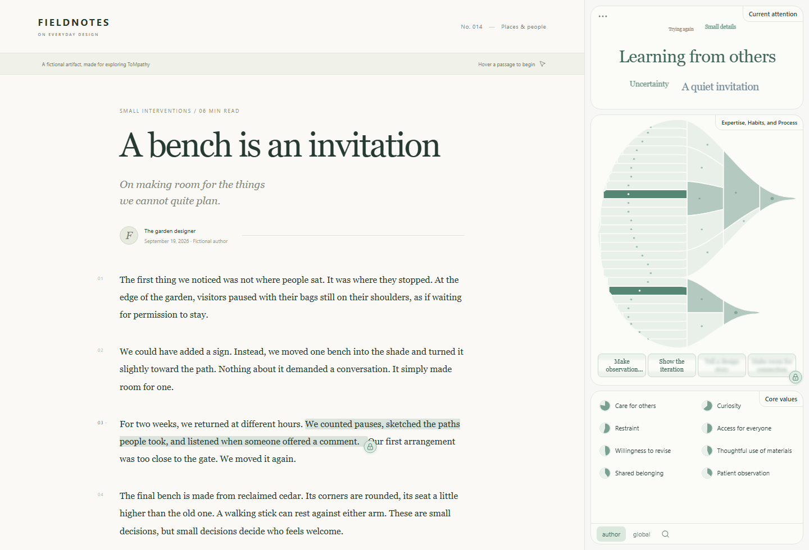

# ToMpathy



**What’s on the author’s mind?** ToMpathy is a Chrome side-panel reader for exploring an author’s current attention, expertise, habits, process and core values alongside a text.

**0.1 beta · MIT licensed · frontend preview.** The bundled example is fictional and hand-authored. A live Sounding Line backend is not connected. Ordinary pages can be captured and paired with a matching imported analysis; the extension does not generate claims about their authors on its own.

## Try the beta

1. Download [tompathy-0.1.0.zip](https://github.com/EmotiveAutomaton/tompathy/releases/download/v0.1.0-beta.1/tompathy-0.1.0.zip) from the [beta release](https://github.com/EmotiveAutomaton/tompathy/releases).
2. Extract it into a folder you will keep. In Chrome, open `chrome://extensions`, enable **Developer mode**, choose **Load unpacked**, and select the extracted folder containing `manifest.json`.
3. Open an article and click **ToMpathy** in Chrome’s extension menu. For the demonstration, open **⋯ Options → How ToMpathy works → Open the example**, then **Open Maker Reader**.
4. Hover a sentence; click to hold it. Move across the hierarchy or hover the reels to inspect possibilities. Click the green lock to release.

No account, API key, paid service or model download is needed for the example, reading-file import/export, or linked-source context. This beta is distributed through GitHub; it is not yet listed in the Chrome Web Store. Unpacked installations update manually: replace the files and click **Reload** on the extension card.

## Three views, one reading

- **Current attention** is an independent, animated word cloud. It follows the pointed sentence or supplied sub-sentence frame; word size reflects the supplied support.
- **Expertise, Habits, and Process** shows local choices flowing toward broader goals. Hold a node and hover the odometer: ambiguous reels grow upward into selectable lists over the faded hierarchy.
- **Core values** shows a stable set of supplied latent-preference hypotheses with evidence and support indicators.

The reader supports keyboard focus, reduced motion, system/light/dark themes, multiple supplied authors, and retained analysis revisions. Estimates are hypotheses, not verified access to a person’s mind or calibrated probabilities unless the input explicitly says so.

## Context and saved readings

**Light context** follows explicit author links. **Use GitHub when possible** retrieves a linked account’s public profile without authentication. Retrieval is bounded and optional; no paid search runs. **Agent search**, author-like local models and word-level analysis are planned controls. Global and search are interface previews. See the [free context design](docs/CONTEXT_RESEARCH.md).

**Export** saves one HTML reading containing captured text, analysis and context. **Import** restores its text beside the reader. The file also opens offline as plain text with reading styles; original site images, CSS and active features are not archived.

See [Privacy](PRIVACY.md) for storage, network behavior and permissions.

## Develop and verify

Node 22.14+ and current Google Chrome:

```sh
npm ci
npm run review
```

The launcher builds the extension and opens a persistent, separate Chrome review profile. On Windows, **Review ToMpathy.cmd** provides the same entry point. It leaves normal Chrome profiles alone. For the design preview, run `npm run dev` and open `http://127.0.0.1:5173/`.

```sh
npm run build
npm test
npx playwright install chromium
npm run test:browser
npm run test:review
npm run package
node scripts/verify-package.mjs
```

[CI](https://github.com/EmotiveAutomaton/tompathy/actions) checks the reader, real extension integration, ordinary Chrome installation and restart recovery, then packages the tested build. Generated browser evidence stays in CI artifacts and local ignored folders.

[Development and QA](docs/DEVELOPMENT.md) · [Result contract](docs/INPUT_CONTRACT.md) · [Distribution plan](docs/DISTRIBUTION.md) · [Release notes](CHANGELOG.md)

## License

[MIT](LICENSE), copyright 2026 EmotiveAutomaton. Bundled dependencies retain their own [notices](THIRD_PARTY_NOTICES.txt).
