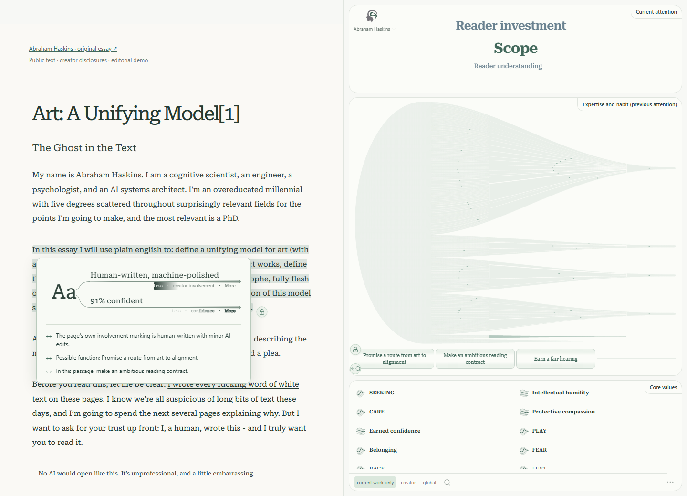

# ToMpathy



**What’s on the creator’s mind?** ToMpathy is a Chrome side-panel reader for exploring a creator’s current attention, expertise, habits, process and core values alongside a text.

**0.3 beta development · MIT licensed · Engine v1.** The Python engine in [engine/](engine/README.md) provides the decision ledger, source adapters, model/evaluation components, static registry generation and authenticated local companion. Scientific admissions remain separate from software checks: unadmitted modules do not supply maker estimates. The commissioned website demo remains hand-authored, fictional analysis.

The [November 20 packet](docs/ENGINE_TEACHER_WORD_TABLE_2026-11-20.md) adds
two GPU queues. The Spark started fresh reader comparisons and the workstation
completed a food-topic reading and started prompt comparisons. The first
[word-table result](docs/exchange/result-sheets/TP34-word-lifts.md) cleared its
registered top-two bar and found a tie on quiet share for all 32 words.
The [food-topic comparison](docs/exchange/result-sheets/TP38-food-topic.md)
found that removing food situations more than halved the food-tag lift for
both *ashamed* and *guilty* on the point estimates. The November 21
[theory return](docs/exchange/THEORY_RETURN_2026-11-21.md) collects the four completed studies.
Reader clearance now follows each card's registered
use. The [nine-channel commission](docs/ENGINE_NINE_CHANNEL_2026-11-19.md)
continues alongside it. Its first export selects the completed frozen need reader
under the existing development rule and preserves all 6,600 saved tag-score
rows. IM2 is delivered privately. The stand-in table passes six of nine rows,
while the separate joy-split prediction fails. The embarrassment/shame label test
is complete: neither account clears its full registered rule. The reader-share
profile study's frozen rung passes its transfer bar on six of seven channels,
but fails its mix test and CARE noninferiority check. The full tables are filed.
Spark's encoder parity check passed and its 500-report CPU/GPU timing is filed.
The original 9B panel is preserved but unqualified: its prompt reversed two
answer-key meanings. The owner approved a separate corrected SP1-v2 panel with
the original reports and thresholds. Both corrected panels fail the correlation
bar. Reader B ranks higher on that panel. TP31 now measures its separate
agreement and known-group requirements before admitting a teacher.
Competence and Meaning
are wired through the engine and panel and verified in native Chrome.
[Source filing](docs/SOURCE_DOCUMENTS.md)
and the [theory return](docs/exchange/THEORY_RETURN_NINE_CHANNEL.md) distinguish
implemented, running and unrun work. No new serving or maker admission follows.

The closed [trigger-reader pass](docs/ENGINE_TRIGGER_READER_2026-11-22.md) adds opt-in
research plumbing. Its worry refit clears three known-group checks, but scores
plain prose 5.95 of 9 on average; it is not a measure of the author.
The completed EX5 choice test trails its rarity control; no personal-choice
or values inference follows.
The new plain-prose gate also misses its sensitivity/silence requirements;
gated counting and new channel/trigger serving remain blocked.
The frozen need-tag reader and all three fine-tuned seeds clear their story and
transfer bars. Development scores select seed 47 among the fine-tuned readers;
the owner closed this test commission on November 19. Four larger-reader folds
are preserved; the fifth was stopped, and final comparison/export remains unrun.
No research job or scheduled checkpoint remains active for this commission.
This does not override the failed serving gate.

The [November readers pass](docs/ENGINE_READERS_2026-11-17.md) adds a default-off
reader-pack contract and source-pinned CPU benchmarks. Initial frozen readers
and the development-selected fine-tuned reader remain below the label and
neutral-text requirements; no pack is qualified. Counting improves on a narrow
mixture benchmark but has not qualified the page-share policy.
The completed worry benchmark explains 30.1% of held-out variance with its
fine-tuned reader; corrected-share and plans checks remain dependency-blocked.
This target-task result does not enable maker inference or change a live default.
The observed-choice and handling extensions miss all four registered gain bars;
their completed aggregate preserves the original results across a numerical repair.
The completed concern/distress reader misses both required correlation bars;
its descriptive caring-label contrasts do not qualify CARE or maker inference.
The cause-word benchmark reaches 63.7% top-three hit rate, clearing its two bars;
this scoped result does not establish motives or enable maker inference.
The smaller-reader Q8 candidate fails numerical parity; the separate Q4_K_M
timing misses the speed target. Longitudinal reading remains dependency-blocked.
Assigned negotiation-priority accuracy also misses its bar and trails BOW;
the final lexical controls reproduce TF-IDF and score 67.5% BM25 / 72.5% rarity
top-choice accuracy on the fixed pilot. The bounded readers queue is closed,
with partial and dependency-blocked work retained explicitly.
Core values now has a first-pass Current Artifact layout with fluencies, five
needs and a bodily-needs area. Author uses attributed dated actions when supplied
and centers the current work. Curves are illustrative; absent life history and
need measurements remain unknown. Hover/focus traces supplied or explicitly
demonstrative connections into attention and expertise. Clicking a need opens
its detail diagram. Authored prose and images are preserved.
The next visual pass gives fluencies the Expertise terminal contour, quiet
individual vectors, narrow Heat/Food/Sleep channels and a tapered Stress graph
with a fading curl. Explanatory captions are removed from the overview.

This branch is **codex/0.3-engine**, based on the reviewed 0.2 frontend. npm uses **0.3.0-beta.1** and Chrome uses **0.3.0** with a beta display name. The stable 0.2 download remains available below. See [our branch and version workflow](docs/VERSIONING.md).

For engine readings, open **Options → Analysis source** and choose a public registry or your local companion. The default provider is None. A connected companion uses **Research preview** by default: local surface readings and model judgments have explicit evidence/status badges. **Analyze capture** requests an exact matching reading; an existing account stays in place until you accept its proposed revision. Preview off uses the admitted path. Personal values stay unknown without the required evidence; preview never maps text topics to drives. See [driver progress and measured limits](docs/DRIVER_IMPLEMENTATION.md).

An explicitly enabled companion also offers **Analyze Wikipedia history**. The
engine can carry a bounded history through literal transcription, pooled
correction/choice fitting and an evidence-linked reading. Native panel converters,
optional posterior fitting and shared research exports are documented in the
[engine integration guide](docs/ENGINE_INTERFACE.md). Each inferred module stays
behind its own research admission.

For live practice, run **Practice ToMpathy.cmd** or `npm run practice`. It starts
the local engine and opens a guided setup with two smaller Wikipedia articles.
Connect once, enable **Follow pages**, and open ToMpathy on an article. While the
panel is open, new active pages are captured and analyzed automatically; Wikipedia
readings include recorded revisions and corrections. You can close the launcher;
the companion stays available until review Chrome closes. Manual analysis remains
available with Follow pages off. [Live practice guide](docs/LIVE_PRACTICE.md).

The [October 16 review guide](docs/REVIEW_READINESS_2026-10-16.md) distinguishes
live inputs, constructed examples and pending research. The stability pass adds
resilient context collection, graph stress coverage and inspectable value curves.
Packet 1.8 carries actual current estimates and supplied uncertainty bounds;
the reader does not invent a trajectory when only one estimate exists.

The [October 25 engine pass](docs/ENGINE_WEEK_2026-10-25_IMPLEMENTATION.md)
turns Core values into a scrollable hierarchy table: broader goals above their
supporting nodes, boldness for supplied confidence, and connections on hover or
focus. Existing diagrams open on click/Enter. It adds optional outline density,
revision timelines and scoped claim resolution while preserving admission gates.
The [offline feature exporter](docs/ENGINE_FEATURE_EXPORT.md) retains its frozen
engine baseline independently of this checkout.

The [November back-half engine pass](docs/ENGINE_BACK_HALF_2026-11-15.md)
adds source-pinned evaluation runners for attention, AI involvement, edit reasons
and goals, plus an experimental reader that reuses model state. Float32 speed
comparisons passed their rank check; the int8 version failed and remains blocked.
The [two-day continuation](docs/ENGINE_TWO_DAY_2026-11-14.md) verifies received
EX1–EX3 inputs and records completed window, float32 KV and smaller-reader
comparisons. The edit-feature and goal word-matching baselines completed; the Q8
comparison stopped at its memory guard with partial results. Goal judgments
remain memory-blocked. Weight-only numerical, prefix and final accuracy checks
passed, but the measured speed missed the target. The first-paint timing comparison
is complete. Robustness stopped at its fixed deadline with 2,026/2,500 documents;
the human-edit feature control completed with macro-F1 0.097 on 300 edits.
All six exploratory history rungs completed; they do not establish history onset
or change the registered results. Optional human Q8 was never launched before the bounded queue closed. It also adds a
default-off empty bottom-box contract. No production
admission follows; EX4/EX5 and CP1/EX6 remain dependencies. The
[completion audit](docs/ENGINE_COMPLETENESS_2026-11-11.md) records implemented
work, verification and remaining dependencies; the [scoreboard](docs/ENGINE_SCOREBOARD.md)
does not substitute software tests for measured accuracy.

The October 17 development changes and pending research work are tracked in the
[engine packet implementation](docs/ENGINE_PACKET_2026-10-17_IMPLEMENTATION.md)
and [local performance record](docs/PERFORMANCE.md). The illustrated help essays
now support full-screen images and sequential navigation; the owner's prose and
original image files remain preserved. The [website essay handoff guide](docs/WEBSITE_ESSAY_HANDOFF_GUIDE.md)
includes exact text, assets, a working preview and reconstruction instructions;
the [final citation audit](docs/REFERENCE_AUDIT_FINAL_2026-10-17.md) records remaining limits.
The [website change sheet](docs/WEBSITE_FINAL_CHANGES_2026-10-17.md) lists the final
link and reference corrections. All seven drive cards share the preference
diagram format; absent measurements remain explicitly illustrative and unspecified.

## Try 0.2

1. Download [tompathy-0.2.0.zip](https://github.com/EmotiveAutomaton/tompathy/releases/download/v0.2.0/tompathy-0.2.0.zip) from the [release](https://github.com/EmotiveAutomaton/tompathy/releases).
2. Extract it into a folder you will keep. In Chrome, open `chrome://extensions`, enable **Developer mode**, choose **Load unpacked**, and select the extracted folder containing `manifest.json`.
3. Open [the live essay](https://abrahamhaskins.org/art/) or [homepage](https://abrahamhaskins.org/) and click **ToMpathy** in Chrome’s extension menu. These pages have commissioned demo analysis. Other websites await matching imported analysis. A fictional offline example is available through **⋯ Options → How ToMpathy works → Open the example**.
4. Hover a sentence; click to hold it. Move across the hierarchy or hover the reels to inspect possibilities. Click the green lock to release.

No account, API key, paid service or model download is needed for the example, reading-file import/export, or linked-source context. This release is distributed through GitHub; it is not yet listed in the Chrome Web Store. Unpacked installations update manually: replace the files and click **Reload** on the extension card.

## Three views, one reading

- **Current attention** is an independent, animated word cloud. It follows the pointed sentence or supplied sub-sentence frame; word size and boldness reflect the supplied support. It retains the last inspected frame between targets; broader graph nodes combine their constituent attention frames. Only the strongest phrases that comfortably fit are shown, with space reserved around the creator control.
- **Expertise (Previous attention)** shows local choices flowing toward broader goals. Wheel to zoom, drag to pan, and use the corner-bracket button to fit the whole hierarchy. Cell-anchored goal labels fade in together as the graph grows. Hover a resolved reel and roll the mouse wheel to choose and lock the adjacent goal at that tier. Hold a node and hover the odometer: ambiguous reels grow upward into selectable lists over the faded hierarchy. The arrow/magnifier below the lock centers highlighted text in the article, including groups with ambiguous reels.
- **Core values** has Current Artifact, Author and Global perspectives. The first two use reliability-weighted teardrops and connected need diagrams; Global retains the hierarchy table. Hover/focus traces supplied connections. Click/Enter on a need opens its diagram. Example connections are illustrative; live connections require explicit supplied evidence.

The Review desk opens the **actual [Art: A Unifying Model essay](https://abrahamhaskins.org/art/)** and **[homepage](https://abrahamhaskins.org/)**. Click ToMpathy in Chrome’s toolbar to read alongside the live page. Images, equations, expandable sections, project dialogs and the original layout stay on the website. Opening a section or project refreshes the analysis for its currently visible text. Mathematical notation remains unmodified; surrounding prose receives sentence annotations. Stable navigation text and the References & Assets footer are included on this demo site; the footer is one reading unit. Transient citation popups are excluded. Unreadable pages explain the access problem and offer a bundled safe example or pasted text; blank pages retain the starting view.

The retained 0.2 authored demo corpus contains **997 essay sentence interpretations**, **21 homepage interpretations**, and **107 sentences across seven project descriptions**. Research preview never loads that corpus onto a live page. In the legacy demo, each captured sentence gets one graph location, a possible purpose, attention and evidence. New or changed text gets a provisional cue. Confidence, attention weights and value trajectories are invented for interaction testing; published Ghost Scale markings are creator disclosures. Help records the matched/provisional counts. None of this is a recovered writing history or live inference.

Graph tiers start with extra width for a useful intermediate layer. **Drag a vertical separator** to resize adjacent tiers; focus it and use left/right arrows, or Home/double-click to restore initial widths. Multiple goal peaks can terminate at different levels. In Core values, a rising contour current identifies a **drive** and layered currents identify a **constructed value**. Current work only and Creator each have seven drive channels and three constructed entries, with different demo accounts; Global has seven drives and eighteen constructed entries. PANIC/GRIEF displays as Belonging. A straight confidence arrow and label weight show confidence. Drive cards put a short definition on the left and a small, faint brain outline with a clearer network on the right; the lifetime curve uses the full card width. All cards contain illustrative trajectories and observations.

The fictional **The door we stopped explaining** fixture remains available at `/?demo=fieldnotes` (or the installed `example.html`) for controlled regression checks and contrasting confidence levels. Original bold becomes underline when involvement is supplied. Reading-grade and confidence-weight fonts are bundled locally; no font-service requests are made.

The reader supports keyboard focus, reduced motion, system/light/dark themes, multiple supplied creators, and retained analysis revisions. Estimates are hypotheses, not verified access to a person’s mind or calibrated probabilities unless the input explicitly says so.

## Context and saved readings

**Light context** records the byline and follows up to three explicit creator links. The setting persists: opening a reading refreshes context where Chrome already grants source access. **Use GitHub when possible** reads linked public profiles and an explicitly linked repository or source file, with up to three recent revisions and small change excerpts. **Agent search** adds one bounded hop of linked pages and feeds: at most six sources, including one repository lookup. It uses no account, model or paid search. Compact progress bars beside Options become a checkmark and fade. **View context and timeline** opens dated source entries, undated facts, retrieval coverage and an exportable brief. Sources remain available for selection into the next backend request; fetching context does not invent new scores. See [implementation and limits](docs/CONTEXT_RESEARCH.md).

Tab enters the graph at one remembered cell. Up/down arrows move between nearby cells; left/right moves between subordinate and broader goals. Click or press Enter to hold a cell and gently center its source text. Plus/minus zoom and Home fits the hierarchy. Scrolling away reveals Find. Hover or focus the question mark after each section label for a short delayed invitation; click it for the illustrated essay. The essay opens over a connected webpage, with a local fallback, and closes through X, Escape or an outside click. Superscript citations link directly to the supplied sources. Options → Bibliography opens the shared, consistently numbered source list. The [essay editing guide](src/content/README.md) records the owner-directed image arrangements and preserved source archive. The original artwork remains above the creator; a thin-outline variant emphasizes the green shape in the 16/32 px extension icons. Dotted extra-parent connections have small endpoint markers.

**Export** saves one HTML reading containing captured text, analysis and context. **Import** restores its text beside the reader. The file also opens offline as plain text with reading styles; original site images, CSS and active features are not archived.

Read the [selected contour-current design for Core values](docs/CORE_VALUES_DESIGN.md). Read the [current UX review and next priorities](docs/UX_REVIEW_0.2_DEVELOPMENT.md).

See [Privacy](PRIVACY.md) for storage, network behavior and permissions.

## Develop and verify

Node 22.14+ and current Google Chrome:

```sh
npm ci
npm run review
```

The launcher builds the extension and opens a persistent, separate Chrome review profile. Its small dashboard links to the live essay, live homepage and twelve copyable image-generation prompts in contrasting visual styles. Open either page, then click the ToMpathy toolbar icon. On Windows, **Review ToMpathy.cmd** provides the same entry point. It leaves normal Chrome profiles alone. For the design preview, run `npm run dev` and open `http://127.0.0.1:5173/`.

```sh
npm run build
npm test
npx playwright install chromium
npm run test:browser
npm run test:review
# Optional network-dependent check against the real public website:
npm run test:website
npm run package
node scripts/verify-package.mjs
```

[CI](https://github.com/EmotiveAutomaton/tompathy/actions) runs on pull requests and main updates. It checks the reader, real extension integration, ordinary Chrome installation and restart recovery, then packages the tested build. Generated browser evidence stays in CI artifacts and local ignored folders.

[Development and QA](docs/DEVELOPMENT.md) · [Result contract](docs/INPUT_CONTRACT.md) · [Distribution plan](docs/DISTRIBUTION.md) · [Release notes](CHANGELOG.md)

## License

[MIT](LICENSE), copyright 2026 EmotiveAutomaton. Bundled dependencies retain their own [notices](THIRD_PARTY_NOTICES.txt).

The MIT license covers the software. The essay snapshot remains attributed to its creator; inclusion does not relicense the essay or its references.
