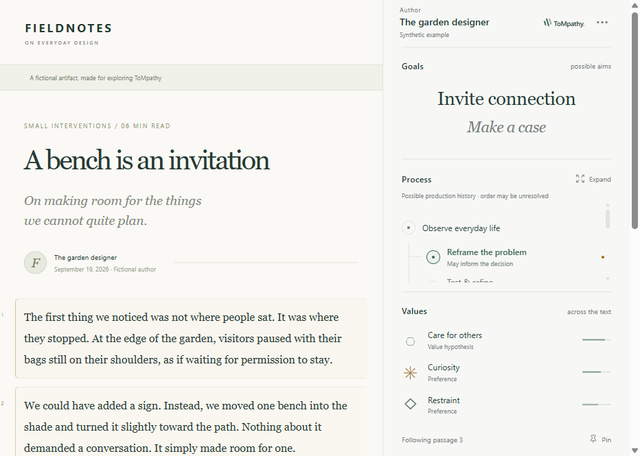

# ToMpathy · Maker Reader

A Chrome side-panel extension for exploring possible goals, processes, and values behind a text. Sounding Line will supply the inference; this frontend already supports capture, imported results, evidence, context, and a complete synthetic example.

The reader has a compact author-first header and three quiet sections: a goal word cloud, a possible production-history tree that expands into a word cloud, and a stable values/preferences list. Select a word or node for evidence. The **⋯ Reader menu** holds source, context, imports, earlier accounts, list view, maker selection, and settings. The main header has no author dropdown in this pass.

Private repository: [EmotiveAutomaton/tompathy](https://github.com/EmotiveAutomaton/tompathy).



## Try it

From a fresh clone, run `npm ci` and `npm run build` first to create `dist/`.

1. Open `chrome://extensions` in Chrome 116 or later and enable Developer mode.
2. Choose **Load unpacked** and select `E:\EmotiveAutomaton\Projects\ToMpathy\dist`. Alternatively, unzip `tompathy-0.2.0.zip` into a folder and load that folder. **The folder picker may look empty because it shows subfolders, not files. Click Select Folder while inside `dist`.** Do not select the project root or the ZIP itself.
3. Pin **ToMpathy** from Chrome's extensions menu. Click its toolbar icon on an ordinary text page.
4. Choose **Explore an example** for the complete experience. It opens the matching fictional source. If needed, use its **Open Maker Reader** button.

Hover a passage to preview its hypotheses; click to pin; Escape releases. Use **Reader menu → Source text** for keyboard passage navigation, or select text on the page. Select a hypothesis to inspect its evidence and jump back to a passage. Values stay fixed for the analysis revision. In **Reader menu → Context**, preview and explicitly accept the example notebook revision to see a change of mind.

Chrome controls side-panel placement. For the intended right-hand layout, choose the right side in Chrome's **Settings → Appearance → Side panel**. The extension respects the existing setting.

The revised native panel was tested in Chromium 153.0.8010.12. Connected Chrome 154.0.8037.98 was used for preview checks. Ordinary Chrome's folder-selection confirmation and toolbar activation remain distinct acceptance checks; see STATUS.md for the current receipt.

## Repeatable Chrome testbed

Run `npm run testbed`. It builds and checks the unpacked extension, generates a fictional author page and matching results, and starts the preview server (or reports that it is already running). Open **http://127.0.0.1:5173/testbed.html** in Chrome. Keep the server terminal open if it started a server.

Optionally run `npm run chrome` in another terminal to open ordinary Google Chrome with the separate `.local/chrome-review` development profile. Load `dist` once and Chrome remembers it in that profile. This launcher does not use automated extension sideloading flags, a debugging port, or your personal Chrome profile.

On the test page, click ToMpathy in the toolbar, download **first account**, then use **Reader menu → Import result**. The source and result are bound to that exact localhost URL. Hover and pin passages, inspect evidence, expand the tree into a cloud, and confirm that values stay fixed. **Context → Preview example revision** demonstrates new evidence. After accepting, use **Earlier accounts** to inspect the original without replacing the current result.

The page links to Simon Willison's Datasette Lite article and its GitHub project for the next public-page check. Capture and inspect those pages, then export a capture or analysis request. The fictional packets cannot be attached to a different article. No live backend is configured.

After editing: rebuild, click **Reload** on the ToMpathy card in `chrome://extensions`, then refresh the source page and reopen the panel. If the extension is absent from the puzzle-piece menu, check that its card is present and enabled in this same Chrome profile. The installed extension runs without Vite; only the localhost preview/test page needs the server.

## Develop

Node 22.14.0 and npm 10.9.2 were used. Install the exact lockfile dependencies:

```sh
npm ci
npx playwright install chromium
npm run dev
```

Open `http://127.0.0.1:5173/` for the page-and-reader preview, or `http://127.0.0.1:5173/?panel` for the panel alone. The web preview is a design/testing surface; page capture and origin permissions belong to the installed extension.

```sh
npm run build
npm test
npm run test:browser
node scripts/native-validation.mjs
node scripts/live-validation.mjs
node scripts/public-testbed-validation.mjs
npm run package
node scripts/verify-package.mjs
```

`build` typechecks and bundles a self-contained `dist/`; no server is needed by the installed extension. `package` creates the development ZIP. Reload the extension in Chrome after rebuilding. Native validation uses an isolated headed profile and localhost CDP port 9334. Live validation contacts three public sources. Neither uses your personal Chrome profile. Ordinary-page tests add narrow fixture/source permissions to copies under `.local/`; the delivered manifest has no permanent page host permissions.

## Inputs, context, and storage

- **Bundled example:** fictional text, maker, scores, and evidence. It is always labeled synthetic and opens its own source.
- **Result import:** versioned JSON, validated and matched to the exact captured artifact, revision, anchors, and selected context. Export a capture from **The source text** for a provider. See [the input contract](docs/INPUT_CONTRACT.md) and [example packet](examples/bench-result.json).
- **Provider:** replaceable TypeScript interface in `src/core/provider.ts`; no live endpoint or credentials are configured.
- **Analysis request export:** source, requested author, and only selected context are exported together. Newly collected context IDs bind the exact source/excerpt and match Sounding Line's offline hash convention. Identical source/excerpt pairs are deduplicated.

Context collection is explicit: at most three HTTPS URLs, one retrieval each, 256 KB per response, a 30-second total deadline, cancellation, no redirects or crawl, and no credentials. Text/Markdown attachments and pasted excerpts work offline. Retrieved items start unselected. Added context never manufactures updated estimates: a matching analysis revision is required.

Preferences persist locally. Captures, context and up to five earlier accepted accounts use `chrome.storage.session`, not browsing-history or maker-profile storage. **Save session** exports JSON only when requested; loading it creates a detached snapshot and deselects imported context. **Clear session** removes the reading and page marks. Browser-session data disappears when Chrome clears the extension session.

## Project map

| Location                                          | Responsibility                                                                    |
| ------------------------------------------------- | --------------------------------------------------------------------------------- |
| `src/App.tsx`, `src/reader.css`, `src/styles.css` | Reader, source preview, dialogs, themes, keyboard interaction                     |
| `src/content.ts`                                  | Bounded text extraction, anchors, local pointer selection, page marks and cleanup |
| `src/browser.ts`, `src/background.ts`             | Chrome boundary, side panel, session/preferences storage                          |
| `src/core/model.ts`                               | Versioned runtime schemas and artifact/scope matching                             |
| `src/core/provider.ts`                            | Future inference adapter interface                                                |
| `src/core/collector.ts`                           | Bounded public-context retrieval                                                  |
| `src/core/example.ts`, `examples/`                | Synthetic artifact, ambiguity, unknown history and explicit correction            |
| `tests/`, `scripts/*validation.mjs`, `evidence/`  | Repeatable checks and measured receipts                                           |

See [STATUS.md](STATUS.md) for verification and remaining limitations. The original [project context](TOMPATHY_PROJECT_CONTEXT.md) remains the intent source.
