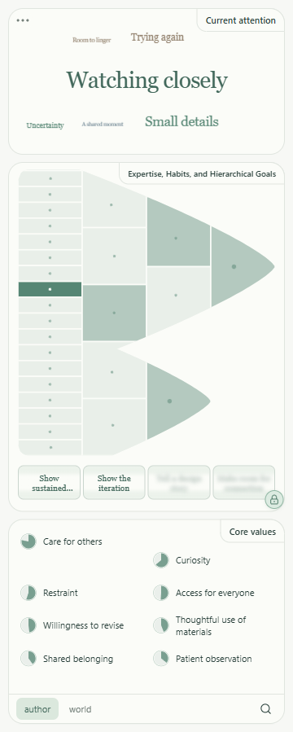

# ToMpathy - What's on the author's mind?

Version **0.4.0 alpha** has three panels: **Current attention**, **Expertise, Habits, and Hierarchical Goals**, and **Core values**. Titles sit in the top-right corners; the Reader menu is at top left. Chrome supplies the compact title and right-pointing pyramid icon. The future public release is intended to restart at **0.1 beta** with an empty frontend; this alpha remains a private development build.

Current attention occupies about half its previous height and is independent of the goal hierarchy. At rest it says **Hover to see**. Hover a sentence or sentence brick: its strongest supplied attentional focus gathers near the center, new phrases grow into place, and shared phrases shift gently. The example deliberately changes its leading focus across sentences.

The continuous, rounded hierarchy now has two peaks at different depths with shared subgoals. Compact two-line reels stay below it; ambiguous descendants, broader goals and earlier endings are blurred. Hovering a brick emphasizes its reel. Single-click text or a brick to lock; scroll over a reel to explore that level. Click either matching green lock, or press Escape, to release. Core values occupy a larger two-column area with eight demo items, capped at nine supplied hypotheses. Bottom tabs switch between **author** and a **world** placeholder; search expands into a typing-only prototype. It sends no query.

The expertise heading includes an illustrated explanation and the creator's line about expertise as a lossy, compressed record of previous attentional focuses. The Reader menu keeps source identity, context, imports, earlier accounts, list view, maker selection, settings and Help.

Sounding Line will supply inference. This frontend supports capture, validated result import, evidence, context, and a fictional hand-authored example. No live inference endpoint is connected. [Input contract 1.0–1.4](docs/INPUT_CONTRACT.md) documents independent attention frames, multiple hierarchy parents/roots, and legacy compatibility. Relative support is never presented as calibrated probability.

Private repository: [EmotiveAutomaton/tompathy](https://github.com/EmotiveAutomaton/tompathy).



## Your daily review loop

**Double-click `Review ToMpathy.cmd` in this project folder.** Or run `npm run review` from PowerShell. This is the recommended entry point: it builds the current code, opens ordinary Google Chrome in a separate review profile, loads the extension, verifies that Chrome reports it enabled, and opens a step-by-step **Review desk**. There is no folder picker and no server to keep running.

On the owner's workstation, the **ToMpathy Review** desktop shortcut opens this same launcher.

1. In the Review desk, click **Open the guided example**.
2. On the fictional article, click **Open Maker Reader**. Confirm the three sections beside the text, with ToMpathy in Chrome’s title bar.
3. Hover sentences and watch the leading attention phrase change. Single-click to hold both attention and reels. Move to a reel and scroll to choose a neighboring goal. Click either green lock or press **Escape** to release. Hover a hierarchy brick to trace its ancestors, descendants and matching source text. Paragraph-level bricks show possible paths in both directions and leave attention at **Hover to see**.
4. Try **author**, **world**, and the search icon at the bottom. World and search are interface prototypes. Move between the value rows to check their wider, passive tooltips. Click an attention phrase or value and follow its evidence back to a passage. Hover the middle heading for its illustrated explanation.
5. Use **Reader menu → Context → Preview example revision → Accept this revision**. Values change to include **Practical care**. **Earlier accounts** lets you inspect the original.
6. Return to the guide and choose **Try a real author**. On Simon Willison’s article, click ToMpathy from Chrome’s puzzle-piece menu and pin it for next time. The reader should say **Awaiting analysis**; **Source text** identifies Simon. Inspect **Reader menu → Source text** and export an analysis request. Live inference is not yet connected.

Bookmark the Review desk with **Ctrl+D in the review profile**. While that Chrome session is open, the bookmark is enough. After a computer restart or closing Chrome completely, double-click the launcher first: Chrome removes extensions installed through its development API at startup, and the launcher restores this one automatically with the same ID. Your Chrome profile and local preferences remain. This behavior is covered by the restart test; browser preference files are not patched to override Chrome’s lifecycle.

After code changes, run the same launcher. A changed build is reloaded; refresh existing source tabs and reopen the reader. An unchanged build with a reading open is left alone. Before updating or ending the browser session, use **Reader menu → Save session** to keep an analysis: captures and accepted accounts use temporary session storage.

The guide shows a version and build fingerprint. For feedback, send that label, the page/passage, your action, what you expected, and what happened. A screenshot helps with visual decisions.

### What the launcher needs

Google Chrome and Node 22.14 or later. The Windows launcher runs `npm ci` automatically if dependencies are missing. It uses `.local/chrome-review`, an isolated persistent profile with a loopback development connection. Keep ordinary personal browsing and sign-ins in your usual profile. The Node launcher also locates Chrome on macOS/Linux, but the owner workflow is verified on Windows.

The initial missing-card investigation found the connected automation Chrome running with `--disable-extensions`; that browser cannot validate extension loading. We cannot retrospectively identify which window the owner used. The new launcher starts its own ordinary Chrome without that flag and verifies installation explicitly. A separate action-handler bug that prevented page-access permission has also been fixed and regression-tested.

### Manual installation, if preferred

From a fresh clone, run `npm ci` and `npm run build` first to create `dist/`.

1. Open `chrome://extensions` in Chrome 116 or later and enable Developer mode.
2. Choose **Load unpacked** and select `E:\EmotiveAutomaton\Projects\ToMpathy\dist`. Alternatively, unzip `tompathy-0.4.0.zip` into a folder and load that folder. **The folder picker may look empty because it shows subfolders, not files. Click Select Folder while inside `dist`.** Do not select the project root or the ZIP itself.
3. Pin **ToMpathy** from Chrome's extensions menu. Click its toolbar icon on an ordinary text page.
4. Choose **Explore an example** for the complete experience. It opens the matching fictional source. If needed, use its **Open Maker Reader** button.

Hover a sentence to preview its hypotheses and roll the goal spools; click to lock; Escape releases. Use **Reader menu → Source text** for keyboard passage navigation, or select text on the page. Select a hypothesis to inspect its evidence and jump back to a passage. Values stay fixed for the analysis revision. In **Reader menu → Context**, preview and explicitly accept the example notebook revision to see a change of mind.

Chrome controls side-panel placement. For the intended right-hand layout, choose the right side in Chrome's **Settings → Appearance → Side panel**. The extension respects the existing setting.

Ordinary Chrome 154.0.8037.98 now passes automated installation, native panel, extension-action capture, and restoration after a full restart. The check invokes Chrome’s real extension action through its development protocol; a physical toolbar click and the Windows folder picker are separate from that automated receipt. See STATUS.md.

## Repeatable Chrome testbed

Run `npm run testbed`. It builds and checks the unpacked extension, generates a fictional author page and matching results, and starts the preview server (or reports that it is already running). Open **http://127.0.0.1:5173/testbed.html** in Chrome. Keep the server terminal open if it started a server.

Use `npm run chrome` to open the review profile with the current built extension. For everyday review, use the bundled example from its Review desk; only this optional HTTP testbed needs the local server.

On the test page, click ToMpathy in the toolbar, download **first account**, then use **Reader menu → Import result**. The source and result are bound to that exact localhost URL. Hover sentences, click to lock, inspect the hierarchy and evidence, and confirm that core values stay fixed. **Context → Preview example revision** demonstrates new evidence. After accepting, use **Earlier accounts** to inspect the original without replacing the current result.

The page links to Simon Willison's Datasette Lite article and its GitHub project for the next public-page check. Capture and inspect those pages, then export a capture or analysis request. The fictional packets cannot be attached to a different article. No live backend is configured.

After editing: rebuild, click **Reload** on the ToMpathy card in `chrome://extensions`, then refresh the source page and reopen the panel. If the extension is absent from the puzzle-piece menu, check that its card is present and enabled in this same Chrome profile. The installed extension runs without Vite; only the localhost preview/test page needs the server.

## Develop

### Continuous integration and delivery

`.github/workflows/verify.yml` runs on pushes and pull requests. It installs lockfile dependencies, typechecks/builds, runs core and browser checks, exercises ordinary Chrome installation and its native side panel under a virtual display, verifies restart restoration, and packages the exact tested build. Successful runs retain the extension ZIP for 14 days; test receipts and failure traces are retained separately. See [GitHub Actions](https://github.com/EmotiveAutomaton/tompathy/actions).

Local delivery is the review launcher. It uses the code currently checked out here and does not pull, merge, or publish automatically. CI prepares a downloadable private artifact; it does not publish to the Chrome Web Store. This keeps daily review one click while source changes still receive automated checks. Main remains unchanged until this branch is merged.

Node 22.14.0 and npm 10.9.2 were used. Install the exact lockfile dependencies:

```sh
npm ci
npx playwright install chromium
npm run dev
```

Open `http://127.0.0.1:5173/` for the page-and-reader preview, or `http://127.0.0.1:5173/?panel` for the panel alone. The web preview is a design/testing surface; page capture and origin permissions belong to the installed extension.

```sh
npm run build
npm test
npm run test:browser
npm run test:review
node scripts/native-validation.mjs
node scripts/live-validation.mjs
node scripts/public-testbed-validation.mjs
npm run package
node scripts/verify-package.mjs
```

`build` typechecks and bundles a self-contained `dist/`; no server is needed by the installed extension. `package` creates the development ZIP. Reload the extension in Chrome after rebuilding. Native validation uses an isolated headed profile and localhost CDP port 9334. Live validation contacts three public sources. Neither uses your personal Chrome profile. Ordinary-page tests add narrow fixture/source permissions to copies under `.local/`; the delivered manifest has no permanent page host permissions.

## Inputs, context, and storage

- **Bundled example:** fictional text, maker, scores, and evidence. Its source page, Reader menu, Help and evidence tools label it synthetic; it opens its own source.
- **Result import:** versioned JSON, validated and matched to the exact captured artifact, revision, anchors, and selected context. Export a capture from **The source text** for a provider. See [the input contract](docs/INPUT_CONTRACT.md) and [example packet](examples/bench-result.json).
- **Provider:** replaceable TypeScript interface in `src/core/provider.ts`; no live endpoint or credentials are configured.
- **Analysis request export:** source, requested author, and only selected context are exported together. Newly collected context IDs bind the exact source/excerpt and match Sounding Line's offline hash convention. Identical source/excerpt pairs are deduplicated.

Context collection is explicit: at most three HTTPS URLs, one retrieval each, 256 KB per response, a 30-second total deadline, cancellation, no redirects or crawl, and no credentials. Text/Markdown attachments and pasted excerpts work offline. Retrieved items start unselected. Added context never manufactures updated estimates: a matching analysis revision is required.

Preferences persist locally. Captures, context and up to five earlier accepted accounts use `chrome.storage.session`, not browsing-history or maker-profile storage. **Save session** exports JSON only when requested; loading it creates a detached snapshot and deselects imported context. **Clear session** removes the reading and page marks. Browser-session data disappears when Chrome clears the extension session.

## Project map

| Location                                         | Responsibility                                                                    |
| ------------------------------------------------ | --------------------------------------------------------------------------------- |
| `src/App.tsx`, `src/components/`, `src/mind.css` | Reader, source preview, dialogs, themes, keyboard interaction                     |
| `src/content.ts`                                 | Bounded text extraction, anchors, local pointer selection, page marks and cleanup |
| `src/browser.ts`, `src/background.ts`            | Chrome boundary, side panel, session/preferences storage                          |
| `src/core/model.ts`                              | Versioned runtime schemas and artifact/scope matching                             |
| `src/core/provider.ts`                           | Future inference adapter interface                                                |
| `src/core/collector.ts`                          | Bounded public-context retrieval                                                  |
| `src/core/example.ts`, `examples/`               | Synthetic artifact, ambiguity, unknown history and explicit correction            |
| `tests/`, `scripts/*validation.mjs`, `evidence/` | Repeatable checks and measured receipts                                           |

See [STATUS.md](STATUS.md) for verification and remaining limitations. The original [project context](TOMPATHY_PROJECT_CONTEXT.md) remains the intent source.
