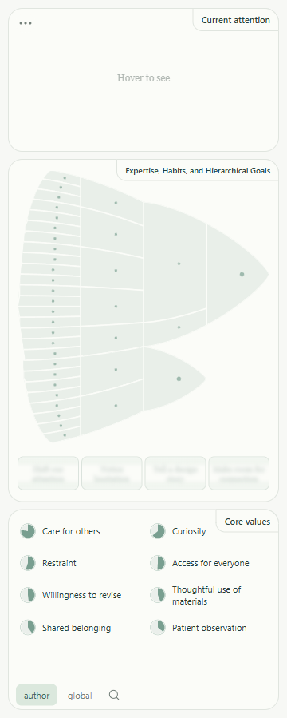

# ToMpathy — What's on the author's mind?

Private **0.4.0 alpha**. Three surfaces: **Current attention**, **Expertise, Habits, and Hierarchical Goals**, and **Core values**. The intended future public release restarts at **0.1 beta**, initially an empty frontend. No live Sounding Line inference endpoint is connected.



## Your review loop

Double-click **ToMpathy Review** on the desktop or [Review ToMpathy.cmd](Review%20ToMpathy.cmd) in this project. Alternatively run `npm run review`. The launcher builds the current code, opens ordinary Google Chrome in a separate persistent review profile, verifies installation, and opens the Review desk. The bundled example needs no local server.

1. Choose **Open the guided example**, then **Open Maker Reader**. You should see exactly three boxes beside the article. A brief, dismissible first-use guide is available; replay it from Options → How ToMpathy works.
2. Hover sentences. Current attention changes independently of the hierarchy. Click to hold a sentence, then move into the panel. Shared phrases persist and new phrases grow into place. At rest the cloud says **Hover to see**, while the reels remain visible and blurred.
3. Click the **Show the iteration** hierarchy brick. Hover any reel: four sentence choices and their broader paths expand with connecting lines. The triangle stays above them. A shared goal has a separate linked brick under each parent, so no brick straddles two outcomes. Scroll a reel, or focus it and use arrow keys, to choose a neighboring goal.
4. Click either matching green lock to release. Escape closes the topmost expansion or dialog before releasing the held sentence. Hover a value for sources; click it for full evidence. Closing evidence should leave your selection in place.
5. Open **⋯ Options**. Author selection is first, followed by Context and the two disabled future controls. System/light/dark sit near the bottom. Help is bottom left; Import/Export are bottom right. **Global** and the adjacent search field remain interface prototypes.
6. Click **Export**. The single HTML file contains a readable copy of the captured page plus analysis, context and retained revisions. Import it to reopen that text beside the extension. The snapshot retains exact text/anchors, not the original site's styling, images or interactive behavior. It also opens offline as plain reading material.
7. Return to the Review desk and try the real-author link. Invoke ToMpathy from Chrome's toolbar/puzzle-piece menu. The active article is captured automatically after Chrome grants access. Options lists detected authors. Estimates await a matching imported result; the extension does not invent them.

Bookmark the Review desk with **Ctrl+D** in the review profile. The bookmark works during an open Chrome session. After closing Chrome completely or restarting Windows, use the launcher first: Chrome removes extensions installed through its development API at startup, and the launcher restores this one with the same ID. Preferences remain; readings are session-local unless exported.

After a code change, run the launcher again, refresh old article tabs and reopen the reader. It updates only changed builds and leaves an unchanged reading open. It does not pull, merge or publish automatically. For feedback, include the version/build label, page, action, expected behavior and screenshot if useful.

## Context in this alpha

Checking **Context** runs a small bounded collector over explicit public author links supplied by the current page. Chrome may ask for access to those origins. It follows at most three links, caps responses at 256 KB and the job at 30 seconds, omits credentials and declines redirects. It cancels when the reading changes. A wheel reports source completion, becomes a check on success, and fades. Partial failure gets no success check.

There is no search API, local summarizer, author training or new inference call connected. Collected excerpts retain provenance and remain separate from the accepted analysis. They do not change scores by themselves. The fictional designer has no public profile to collect. See [the context implementation research](docs/CONTEXT_RESEARCH.md) for the recommended next architecture, costs and alternatives.

The interface follows active tabs and navigation, but Chrome's `activeTab` access is temporary. Invoke the toolbar action on a new site to grant access. Fully automatic access across every site would require a broader permission choice.

## Development tools

Options contains daily controls only. In the Review desk, expand **Development tools and example revisions**, open its special example, and click **Open Maker Reader**. A small Development tools control appears in that test panel. The normal example opens a clean panel.

Development tools retain source/capture exports, raw packet import, manual context inputs, revision fixtures, earlier accounts and session diagnostics. To demonstrate a change of mind: **Context → Preview example revision → Accept this revision**. Values change to **Practical care**. Earlier accounts retains the original. These controls are outside product Options.

For browser-preview QA use `http://127.0.0.1:5173/?qa`, or `/?panel&qa` for the panel alone. The preview is useful for design work; only installed-extension checks prove native side-panel/page integration.

## Setup and checks

Node 22.14 or later and Google Chrome. `Review ToMpathy.cmd` installs lockfile dependencies if missing. The review profile is `.local/chrome-review`; keep personal browsing in the usual Chrome profile.

```sh
npm ci
npx playwright install chromium
npm run dev
npm run build
npm test
npm run test:browser
npm run test:review
npm run test:native
npm run package
node scripts/verify-package.mjs
```

The build writes a self-contained `dist/`. For manual installation: open `chrome://extensions`, enable Developer mode, choose **Load unpacked**, select this project's **dist** folder, then click **Select Folder** even if the folder picker appears empty. The project root and ZIP are not unpacked extension folders. Chrome 116 is the minimum; the current native verification uses ordinary Chrome 154. The optional `npm run testbed` starts a localhost article with matching downloadable packets. Import them through Options → Import.

The initial missing-card investigation found the connected automation Chrome running with `--disable-extensions`; it could not validate loading. The review launcher uses a separate ordinary Chrome without that flag. It also exercises the extension action, native panel and restoration after a full browser restart. The physical Windows folder picker is separate from those automated checks.

Chrome controls side-panel placement. For the intended right-side layout use Chrome Settings → Appearance → Side panel.

## Continuous integration and delivery

[Private GitHub Actions](https://github.com/EmotiveAutomaton/tompathy/actions) builds, runs core/browser checks, tests ordinary Chrome installation and its native panel, verifies restoration after restart, and packages the exact tested extension. Successful ZIP artifacts remain available for 14 days. Local delivery is the one-click review launcher. This branch is `codex/author-first-testbed`; no public store release is made by CI.

## Architecture and inputs

| Location | Responsibility |
| --- | --- |
| `src/App.tsx`, `src/components/`, `src/mind.css` | Three-panel reader, Options, evidence, connected reels and saved-page UI |
| `src/core/hierarchy.ts`, `attention.ts` | Supplied graph geometry and independent attention selection |
| `src/content.ts`, `src/browser.ts`, `src/background.ts` | Exact text capture, page interaction and Chrome boundary |
| `src/core/model.ts`, `reading-file.ts` | Packet/session validation and portable reading files |
| `src/core/collector.ts`, `page.ts` | Bounded retrieval and explicit author-link discovery |
| `src/core/provider.ts` | Future inference adapter; no endpoint or credentials configured |
| `tests/`, `scripts/*validation.mjs`, `evidence/` | Repeatable verification and inspected evidence |

[Input contract 1.0–1.4](docs/INPUT_CONTRACT.md) covers legacy results, independent attention frames, multiple hierarchy parents/roots and exact artifact matching. All demo text, interpretations and scores are fictional and hand-authored. Relative support is not presented as calibrated probability. Captured text and contexts use temporary browser-session storage; preferences persist locally. Explicit Export saves a reading to disk.

See [STATUS.md](STATUS.md) for the current verification state and [the project brief](TOMPATHY_PROJECT_CONTEXT.md) for the original intent. Later owner walkthroughs supersede older naming and menu decisions in that brief.
