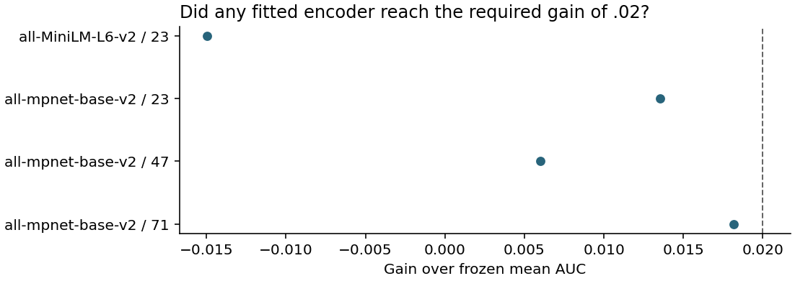

# Did a larger encoder read the seven writers’ words more accurately?

We compared saved word predictions from MiniLM and MPNet with the frozen reader on the same sources.

MPNet missed both thresholds in every seed. MiniLM had one measured seed. ModernBERT is pending.

| Encoder | Seed | Mean AUC | Gain over frozen | CARE AUC |
|---|---:|---:|---:|---:|
| all-MiniLM-L6-v2 | 23 | 0.7897 | -0.0150 | 0.6716 |
| all-mpnet-base-v2 | 23 | 0.8182 | +0.0135 | 0.6960 |
| all-mpnet-base-v2 | 47 | 0.8107 | +0.0060 | 0.6663 |
| all-mpnet-base-v2 | 71 | 0.8228 | +0.0182 | 0.6758 |

Mean AUC gain at least .02 and CARE AUC at least .70 on all three larger-model seeds.

Held-out writers' words and reader votes are stand-ins. Co-rise describes predictions. ED is research-only.

[Aggregate E-G2-FIRST-RUNGS-20261121](../../../engine/validation/readers-profile-fine-first-rungs-2026-11.json)

