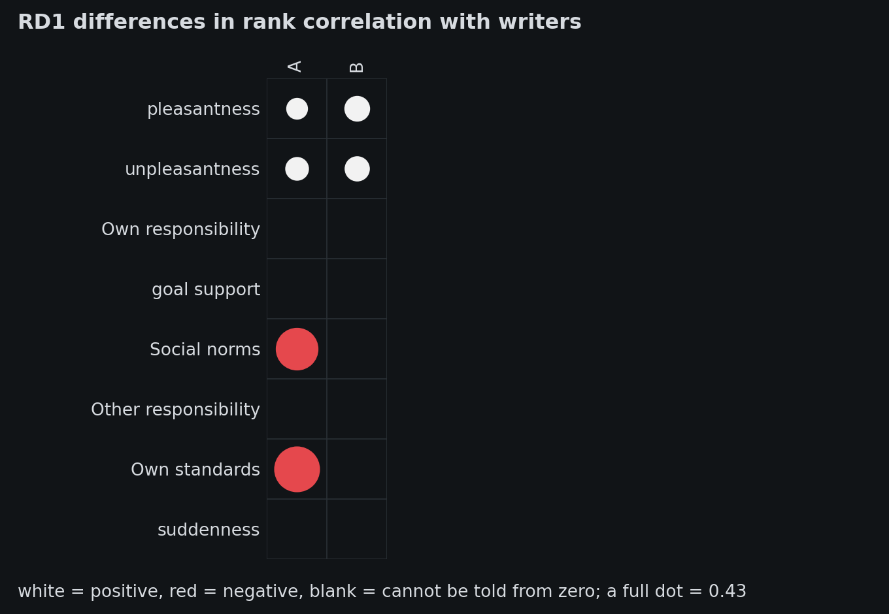

# RD1 reader allocation

Each difference is the reader’s rank correlation with writers minus the trained reader’s on the same valid reports. The interval uses 2,000 paired report draws.

| Feature | A difference, 95% interval | B difference, 95% interval | Selected reader |
|---|---:|---:|---|
| pleasantness | 0.097 [0.035, 0.162] | 0.136 [0.080, 0.197] | B |
| unpleasantness | 0.116 [0.054, 0.182] | 0.131 [0.068, 0.199] | B |
| Own responsibility | 0.004 [-0.075, 0.090] | -0.034 [-0.122, 0.052] | trained |
| goal support | -0.023 [-0.100, 0.057] | 0.016 [-0.057, 0.090] | trained |
| Social norms | -0.373 [-0.500, -0.246] | -0.029 [-0.135, 0.072] | trained |
| Other responsibility | -0.022 [-0.122, 0.087] | 0.028 [-0.062, 0.116] | trained |
| Own standards | -0.431 [-0.562, -0.289] | -0.073 [-0.168, 0.028] | trained |
| suddenness | -0.020 [-0.113, 0.073] | 0.020 [-0.066, 0.105] | trained |

| Panel | Feature | Mean single rereader correlation | Estimable rereaders | Five-rereader mean correlation |
|---|---|---:|---:|---:|
| F1 | pleasantness | 0.768 | 364 of 968 | 0.777 |
| F1 | unpleasantness | 0.690 | 390 of 968 | 0.731 |
| F1 | Own responsibility | 0.579 | 366 of 968 | 0.684 |
| F1 | goal support | 0.508 | 347 of 968 | 0.584 |
| F1 | Social norms | 0.594 | 200 of 968 | 0.490 |
| F1 | Other responsibility | 0.506 | 394 of 968 | 0.597 |
| F1 | Own standards | 0.490 | 328 of 968 | 0.575 |
| F1 | suddenness | 0.525 | 401 of 968 | 0.633 |

A panel of 350 places a rank correlation within about 0.05 either way. Writers' ratings are one person's account of an event, so no reader can be expected to match them fully; the human reference says how far a careful stranger gets.

Evidence ledger E-RD1-20261120. [Paired estimates and valid counts](RD1-comparisons.csv) · [Source-bound aggregate](../../../engine/validation/readers-feature-slots-2026-11.json).
