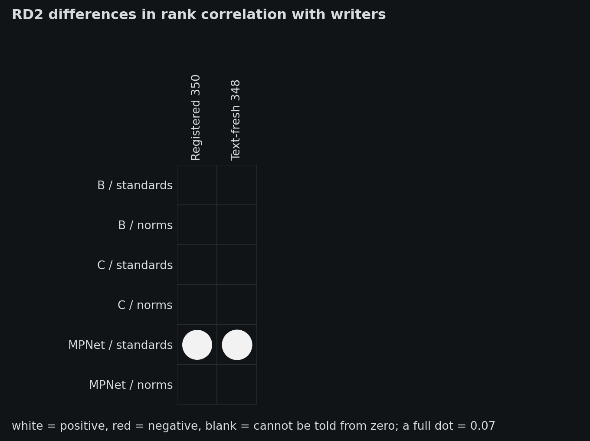

# RD2 standards and social norms

Writers rated how well an event fit their own standards and social norms. We checked which readers came closest on 350 held-out reports, then checked again after removing two repeated texts.

Both views use the same saved forecasts, paired valid reports and 2,000 paired report draws. A nomination requires a 95% interval wholly above zero. Prior trained-reader comparison against writer ratings included all 200; slot confirmation unavailable.

| Candidate | Feature | Registered 350 difference, 95% interval | Text-fresh 348 difference, 95% interval | F2 nomination (350 / 348) | Changed conclusion |
|---|---|---:|---:|---|---|
| B development winner | Own standards | -0.000 [-0.095, 0.095] | -0.000 [-0.096, 0.093] | no / no | none |
| B development winner | Social norms | 0.072 [-0.026, 0.160] | 0.073 [-0.018, 0.161] | no / no | none |
| C | Own standards | 0.047 [-0.037, 0.130] | 0.047 [-0.040, 0.133] | no / no | none |
| C | Social norms | 0.051 [-0.037, 0.134] | 0.052 [-0.036, 0.136] | no / no | none |
| mpnet-base | Own standards | 0.063 [0.009, 0.116] | 0.065 [0.015, 0.115] | yes / yes | none |
| mpnet-base | Social norms | 0.002 [-0.059, 0.065] | 0.003 [-0.059, 0.064] | no / no | none |

The registered panel has 350 distinct report IDs. The sensitivity panel omits the two prespecified text overlaps. Eight candidate comparisons are possible across both features.

mpnet-base — complete.

ModernBERT-large — No complete five-fold trained predictions at this boundary.

| Reader C comparison | Features at or above B | Six-feature rule |
|---|---:|---|
| Registered 350 | 5 of 8 | misses |
| Text-fresh 348 | 5 of 8 | misses |

Reader C’s research-reader conclusion agrees across both panels.
Every feature gives the same C-versus-B conclusion across both panels.

| Feature | C rho / B rho on 350 | Valid pairs | C rho / B rho on 348 | Valid pairs |
|---|---:|---:|---:|---:|
| pleasantness | 0.747 / 0.763 | 350 | 0.746 / 0.762 | 348 |
| unpleasantness | 0.767 / 0.750 | 350 | 0.767 / 0.749 | 348 |
| Own responsibility | 0.575 / 0.648 | 350 | 0.573 / 0.647 | 348 |
| goal support | 0.647 / 0.625 | 350 | 0.645 / 0.623 | 348 |
| Social norms | 0.525 / 0.419 | 350 | 0.524 / 0.417 | 348 |
| Other responsibility | 0.547 / 0.547 | 350 | 0.546 / 0.545 | 348 |
| Own standards | 0.566 / 0.468 | 350 | 0.563 / 0.476 | 348 |
| suddenness | 0.413 / 0.464 | 350 | 0.416 / 0.463 | 348 |

| Panel | Feature | Mean single rereader correlation | Estimable rereaders | Five-rereader mean correlation |
|---|---|---:|---:|---:|
| Registered 350 | Own standards | 0.564 | 342 of 943 | 0.609 |
| Registered 350 | Social norms | 0.598 | 242 of 943 | 0.503 |
| Text-fresh 348 | Own standards | 0.567 | 341 of 939 | 0.607 |
| Text-fresh 348 | Social norms | 0.598 | 242 of 939 | 0.503 |

Two features in one source of recalled events written to a feeling word.

Evidence ledger E-RD2-20261121. [Paired estimates and valid counts](RD2-comparisons.csv) · [Source-bound aggregate](../../../engine/validation/readers-standards-panel-2026-11.json).
