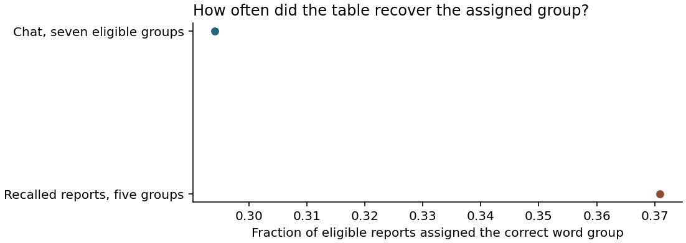

# How often did the fixed table recover the writer’s assigned word group in chat situations?

The reader scored 20,052 short situations. We compared its first choice with the writer’s assigned group wherever the seven-group mapping applies.

2,205 of 7,496 eligible situations matched (29.4%), versus 37.1% on recalled reports.

| Writer group | Eligible | Correct | Table emits group |
|---|---:|---:|---|
| SEEKING | 1970 | 0 | False |
| CARE | 1107 | 0 | False |
| PANIC/GRIEF | 1914 | 1094 | True |
| RAGE | 712 | 106 | True |
| FEAR | 649 | 463 | True |
| DISGUST | 640 | 285 | True |
| SHAME | 504 | 257 | True |

Descriptive comparison against the recalled-report rate. No pass threshold.

Ordered ED prefix, seven writer stand-ins, five emitted channels. Feature validity has no writer rating here. ED research only.

[Aggregate E-TP24-CHAT-20261121](../../../engine/validation/readers-trigger-chat-prefix-2026-11.json)

