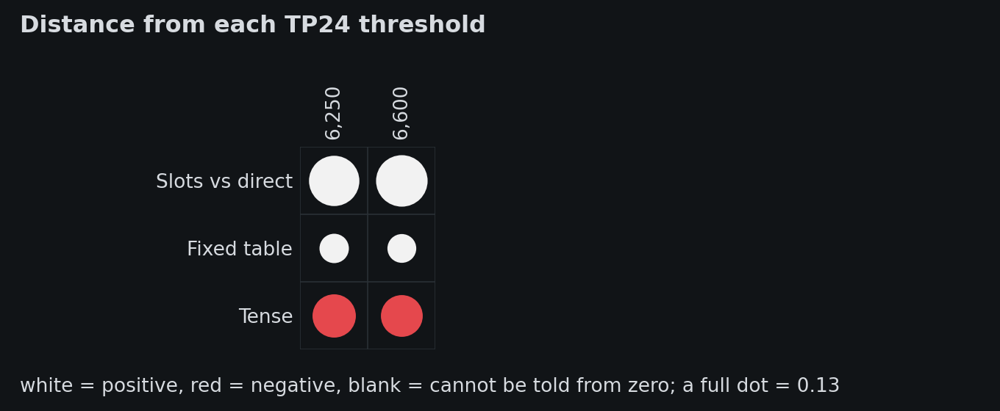

# TP24 on recalled-event reports

On the extended roster, the fitted slots identified the writer’s word on 54.3% of the five-word cases, compared with 51.2% for the direct reader. The fixed table reached 37.1% against its 33% threshold. The tense rule missed its 0.60 threshold on both rosters, so the scored table used the other slots alone. Across all 6,600 reports the fixed table and TP30 chose different channels 4,853 times. The largest disagreement was the table choosing SHAME while TP30 chose SADNESS, on 1,214 reports.

Recalled-event feeling words and text-derived feature forecasts. The downstream folds hold out writers. The five training-report feature folds also hold out writers. The original 1,200-report TP10 test shares writers with its training set. The fixed table was developed with knowledge of this corpus.

| Reading (95% writer interval) | Initial 6,250 reports | Extended 6,600 reports |
|---|---:|---:|
| RD1 slots, five-way accuracy | 0.539 [0.519, 0.558] | 0.543 [0.522, 0.563] |
| Direct reader, five-way accuracy | 0.514 [0.494, 0.535] | 0.512 [0.492, 0.531] |
| Paired accuracy difference | 0.025 [0.002, 0.048] | 0.031 [0.009, 0.054] |
| Fixed table, five-way accuracy | 0.373 [0.354, 0.392] | 0.371 [0.352, 0.390] |
| Ahead for fear versus sadness, AUC | 0.508 [0.483, 0.533] | 0.514 [0.491, 0.538] |
| Top-channel agreement with TP30 | 0.266 [0.254, 0.278] | 0.265 [0.254, 0.276] |

The five-word comparisons cover 2,338 and 2,475 reports respectively. The intervals use 2,000 paired whole-writer resamples of saved forecasts. The registered decisions use point estimates.

## Where the table and TP30 disagreed

Rows show the fixed table’s first choice. Columns show TP30’s first choice among the same five channels. The extended roster had no ties for first place. TP30’s SHAME output was constant.

| Table choice | RAGE | FEAR | SADNESS | SHAME | DISGUST |
|---|---:|---:|---:|---:|---:|
| RAGE | 133 | 22 | 538 | 0 | 61 |
| FEAR | 126 | 180 | 877 | 0 | 87 |
| SADNESS | 114 | 34 | 1289 | 0 | 89 |
| SHAME | 474 | 87 | 1214 | 0 | 77 |
| DISGUST | 268 | 39 | 746 | 0 | 145 |

## Five-word predictions on the extended roster

Rows give the writer’s word. Each cell gives the fixed-table count followed by the fitted-classifier count.

| Writer’s word | anger | fear | sadness | shame | disgust |
|---|---:|---:|---:|---:|---:|
| anger | 122 / 289 | 89 / 61 | 75 / 79 | 141 / 32 | 123 / 89 |
| fear | 63 / 45 | 289 / 333 | 53 / 83 | 117 / 30 | 28 / 59 |
| sadness | 48 / 89 | 135 / 80 | 220 / 308 | 83 / 27 | 64 / 46 |
| shame | 26 / 62 | 22 / 39 | 46 / 41 | 144 / 98 | 37 / 35 |
| disgust | 102 / 96 | 176 / 69 | 46 / 51 | 83 / 19 | 143 / 315 |

The full aggregate includes both rosters, all seven classifier comparisons and the counts where only the fitted classifier recovered the writer’s word. [Aggregate for ledger E-TP24-RECALLED-20261120](../../../engine/validation/readers-trigger-mixed-reports-2026-11.json) · [Figure values](TP24-reports-cells.csv)
