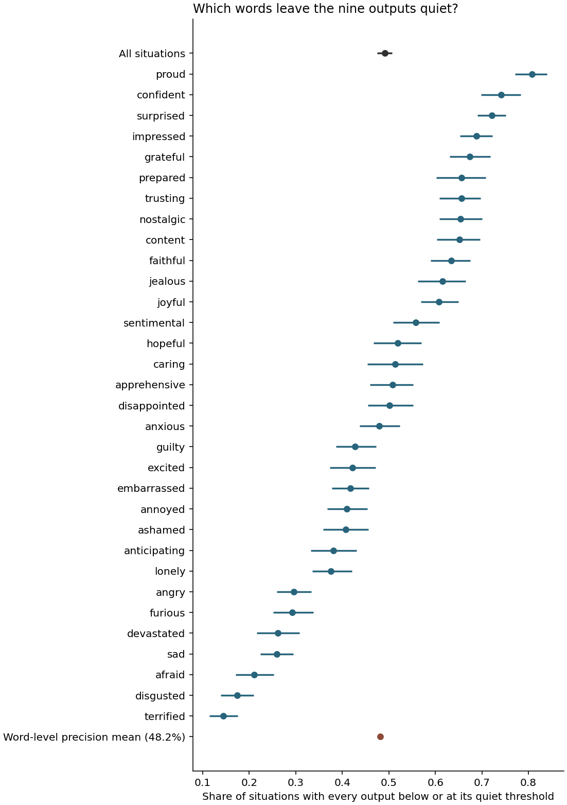

# Which words most often leave every varying output quiet?

We compared 24,850 chat situations with the same nine forecasts, giving each assigned word its own row.

Quietest four: proud, confident, surprised, impressed.

| Word | Quiet / total | Share (95% interval) | Mean highest z |
|---|---:|---:|---:|
| all | 12202/24850 | 0.491 [0.475, 0.507] | 1.720 |
| proud | 700/867 | 0.807 [0.772, 0.840] | 0.501 |
| confident | 582/785 | 0.741 [0.698, 0.783] | 0.759 |
| surprised | 922/1279 | 0.721 [0.690, 0.751] | 0.860 |
| impressed | 554/805 | 0.688 [0.653, 0.723] | 0.978 |
| grateful | 549/815 | 0.674 [0.631, 0.718] | 0.978 |
| prepared | 503/766 | 0.657 [0.602, 0.708] | 1.058 |
| trusting | 427/651 | 0.656 [0.609, 0.697] | 1.036 |
| nostalgic | 496/759 | 0.653 [0.608, 0.700] | 1.128 |
| content | 480/737 | 0.651 [0.603, 0.696] | 1.131 |
| faithful | 303/478 | 0.634 [0.589, 0.675] | 1.308 |
| jealous | 466/757 | 0.616 [0.562, 0.665] | 1.370 |
| joyful | 468/770 | 0.608 [0.569, 0.650] | 1.387 |
| sentimental | 389/698 | 0.557 [0.509, 0.608] | 1.413 |
| hopeful | 405/781 | 0.519 [0.467, 0.570] | 1.740 |
| caring | 351/683 | 0.514 [0.454, 0.573] | 1.982 |
| apprehensive | 309/608 | 0.508 [0.460, 0.553] | 1.437 |
| disappointed | 386/770 | 0.501 [0.455, 0.552] | 1.615 |
| anxious | 371/774 | 0.479 [0.437, 0.524] | 1.537 |
| guilty | 325/760 | 0.428 [0.386, 0.473] | 1.909 |
| excited | 396/938 | 0.422 [0.374, 0.471] | 2.136 |
| embarrassed | 309/740 | 0.418 [0.377, 0.458] | 2.092 |
| annoyed | 359/876 | 0.410 [0.367, 0.454] | 1.818 |
| ashamed | 256/628 | 0.408 [0.359, 0.457] | 2.193 |
| anticipating | 287/754 | 0.381 [0.332, 0.431] | 2.221 |
| lonely | 306/814 | 0.376 [0.336, 0.420] | 1.916 |
| angry | 255/863 | 0.295 [0.259, 0.333] | 2.227 |
| furious | 222/759 | 0.292 [0.251, 0.338] | 2.244 |
| devastated | 186/712 | 0.261 [0.216, 0.308] | 2.494 |
| sad | 222/857 | 0.259 [0.224, 0.295] | 2.435 |
| afraid | 168/797 | 0.211 [0.171, 0.253] | 2.730 |
| disgusted | 137/787 | 0.174 [0.139, 0.209] | 3.671 |
| terrified | 113/782 | 0.145 [0.115, 0.176] | 3.006 |

Descriptive ranking by share with no varying output above one source standard deviation.

Writer-assigned words on one source. All-situations rate directly counts the full cohort.

[Aggregate E-TP34-BK-20261121](../../../engine/validation/readers-quiet-words-2026-11.json)

The word-level precision mean is 48.2%, with inverse variances approximated from the 32 writer interval widths. Writers contribute to several words. All nine outputs varied. The all-situations row directly counts every situation.
