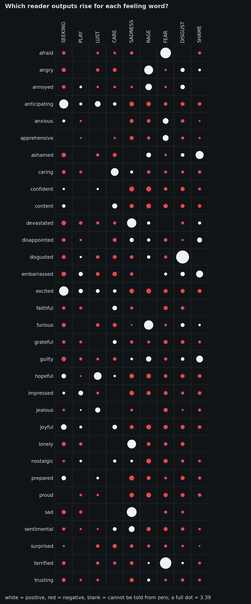

# Which reader outputs rise for each feeling word?

The blind list placed 9 of 19 named outputs in the top two for their word, one above the reference cutoff of 8. Allowing a third place gave 12 hits against a cutoff of 10. The SEEKING output for “disappointed” was 0.29 standard deviations lower than for the remaining words, with a 95% writer interval from −0.32 to −0.26. The quiet-word table ties all 32 words at zero because every situation exceeded the SHAME floor of zero.

The reader was trained on strangers' labels of forum comments. SHAME's output rests on one source. LUST's stand-in means wanting in general. A row is a recipe for a word and not a reading of a channel.

[Word lifts and intervals](TP34-word-lifts.csv) · [Quiet shares and mean largest output](TP34-quiet.csv) · [Aggregate for ledger E-TP34-20261120](../../../engine/validation/readers-word-recipes-2026-11.json)
