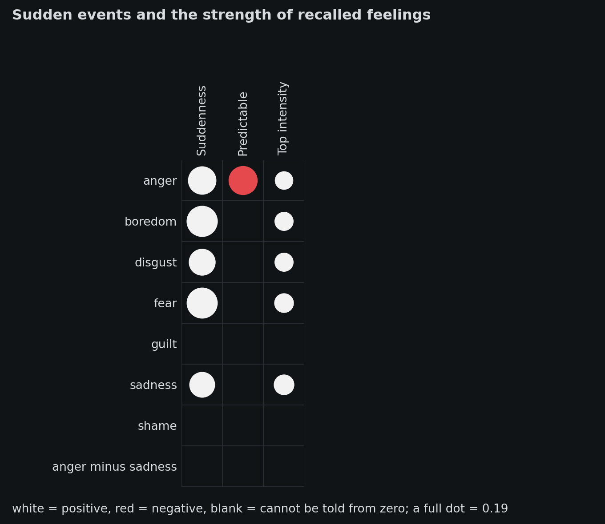
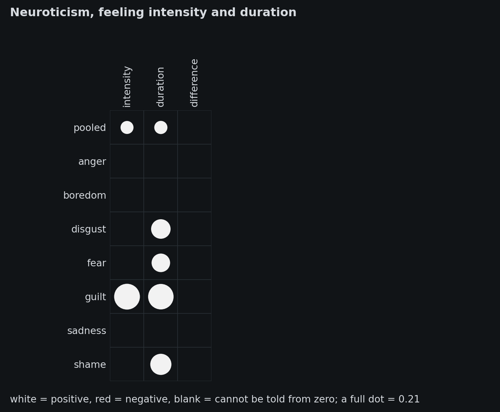

# Suddenness, intensity and duration

Within 550 anger reports, a one-standard-deviation rise in suddenness went with 0.161 standard deviations more intensity, holding unpleasantness and responsibility constant. The writer interval was [0.072, 0.247], clearing the registered anger bar. The slope among 550 sadness reports was 0.133, leaving an anger advantage of only 0.028 with an interval of [−0.097, 0.153]. Across 1,590 writers, the two-item Neuroticism score had similar associations with feeling duration and intensity. Their difference was 0.001, with an interval of [−0.044, 0.052].

A report is a remembered case of a word, chosen to fit it, and not a sample of moments. Suddenness and intensity are one person's ratings made together afterwards. The Neuroticism score is two items and the comparison is between people.

The top-intensity column shows the change in probability of giving the highest rating per standard deviation of suddenness.

[Within-word cells](TP35-within-word.csv) · [Between-writer cells](TP35-duration.csv) · [Aggregate for ledger E-TP35-20261120](../../../engine/validation/readers-suddenness-2026-11.json)
