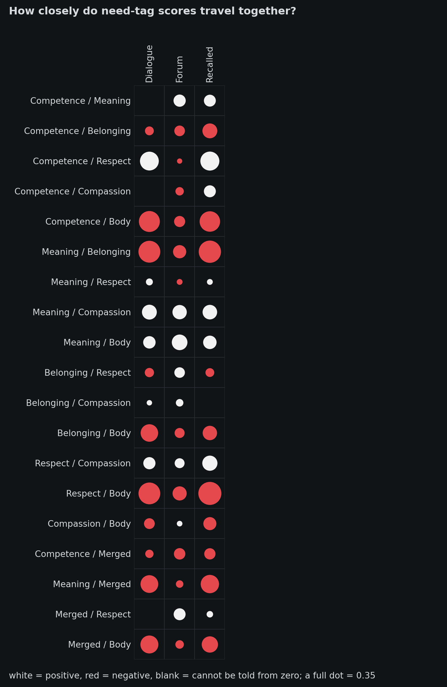

# Which need-tag scores travel together?

All 45 correlations among the six separate need scores fell below the registered .80 threshold. Competence and Respect had the highest correlation in dialogue situations (.236) and recalled events (.241). Meaning and Body led in forum comments (.163). Belonging and Compassion correlated .020 in dialogue, .038 in forum comments and −.013 in recalled events, so their predicted first-place finish occurred in zero of three sources. The four merged rows show how the remaining scores relate to Belonging when its tags include Compassion.

A tag is a word-proxy reader's contrast. Which tag belongs to which need is the map's. What a text is about is not what moved in its writer.

[All movement shares, correlations and intervals](TP36-pairs.csv) · [Figure cells](TP36-correlations.csv) · [Aggregate for ledger E-TP36-20261120](../../../engine/validation/readers-need-pairs-2026-11.json)
