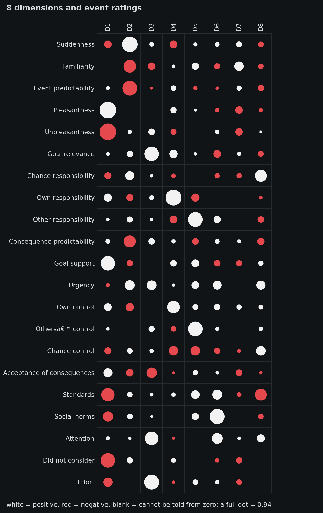
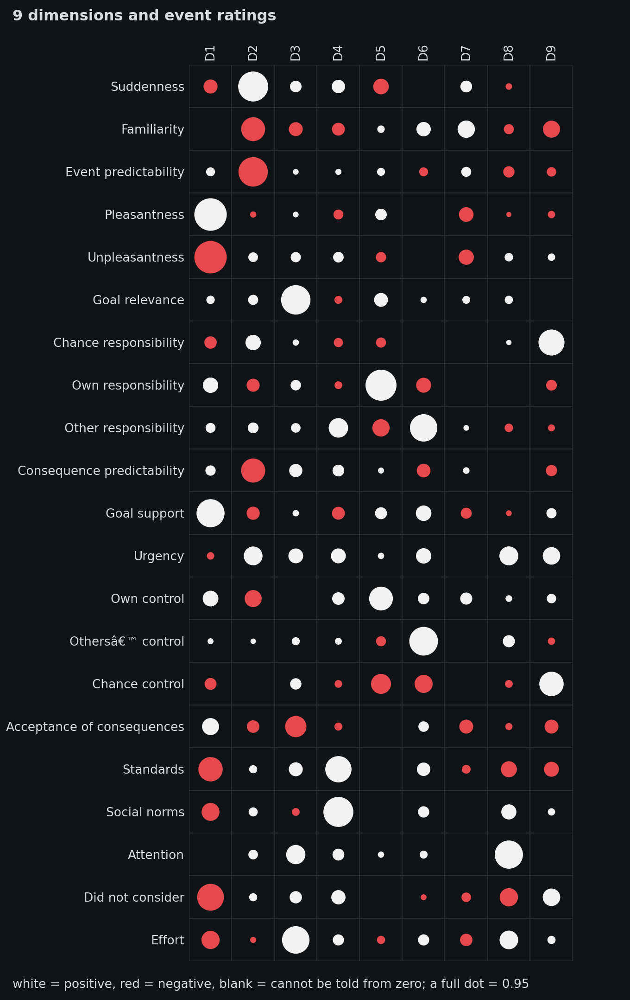

# TP37 dimensions and event ratings

Across 6,600 reports, eight dimensions brought held-out loss within one standard error of the best fit. Nine consecutive additions improved loss by more than twice the standard error of each paired gain. Pleasantness and unpleasantness pointed in opposite directions on the first axis. Suddenness and low predictability characterized the second. The channel names below are the analyst’s reading of these axes.

One source, one kind of data, words chosen by the task and not by the writer.

## One-standard-error rule

| Dimension | Closest trigger, by inspection | Basis for the name |
|---|---|---|
| D1 | PLAY | Broad positive valence, especially joy and pride. |
| D2 | FEAR | Sudden, unpredictable events. Surprise is the strongest positive word. |
| D3 | SEEKING | Effort, attention and goal relevance. |
| D4 | SHAME | Own responsibility and control, with guilt and shame. |
| D5 | RAGE | Another person’s responsibility and control, with anger. |
| D6 | DISGUST | Norms and standards, with disgust the strongest word. |
| D7 | SEEKING, weak inverse | Familiarity and the no-emotion reports anchor this contrast. |
| D8 | FEAR | Chance responsibility and fear, with anger on the opposite side. |

[All 8-dimension estimates and 95% writer intervals](TP37-ratings-rank-8.csv)

## Consecutive paired-gain rule

| Dimension | Closest trigger, by inspection | Basis for the name |
|---|---|---|
| D1 | PLAY | Pleasantness, goal support, joy and pride. |
| D2 | FEAR | Suddenness and low predictability, strongest for surprise. |
| D3 | SEEKING | Goal relevance and effort, contrasting with boredom and no emotion. |
| D4 | DISGUST | Social norms and standards, strongest for disgust. |
| D5 | SHAME | Own responsibility, with guilt and shame. |
| D6 | RAGE | Another person’s responsibility and control, with anger. |
| D7 | SEEKING, weak inverse | Familiarity and the no-emotion reports; a weak match. |
| D8 | FEAR | Attention and urgency, highest for fear. |
| D9 | SADNESS, weak | Chance responsibility and control, positive for sadness and fear. |

[All 9-dimension estimates and 95% writer intervals](TP37-ratings-rank-9.csv)

Both counts are floors on this word task. The intervals condition on the fitted axes and their orientation. [Aggregate and all 65 fold losses](../../../engine/validation/readers-rating-dimensions-2026-11.json).
