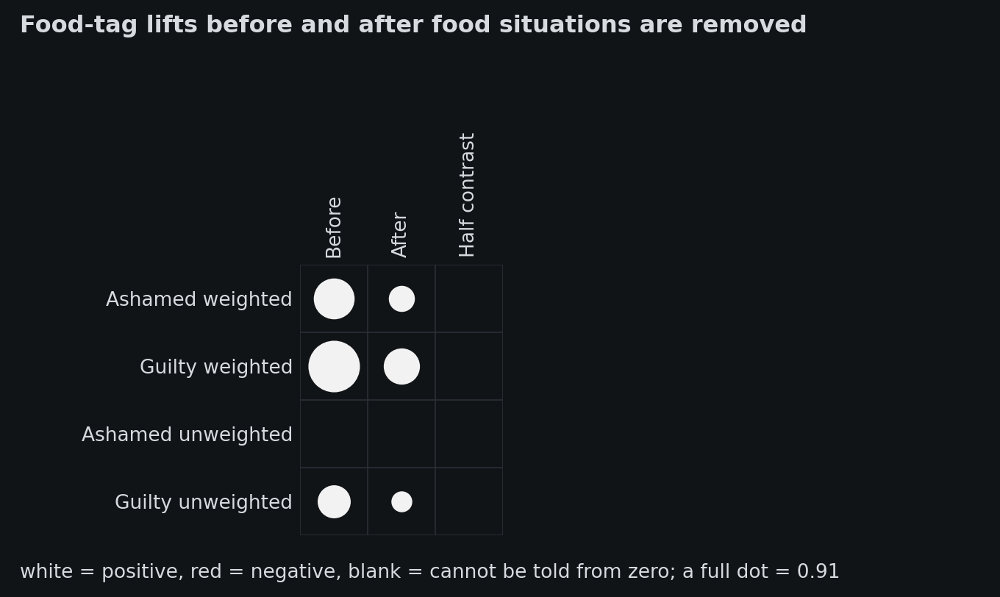

# Food as a topic in ashamed and guilty situations

Removing situations that reader W marked as food reduced the food-tag lift by
59.2% for *ashamed* and 50.6% for *guilty*. Both point estimates clear the
registered threshold of more than half. For both words the writer interval
also allows a reduction smaller than half. This supports food as a story-topic
explanation for these two cells in the earlier word table.

| Word | Lift before removal | Lift after removal | After minus half of before, 95% interval |
|---|---:|---:|---:|
| Ashamed | .571 | .233 | −.053 [−.173, .078] |
| Guilty | .908 | .448 | −.006 [−.159, .165] |

Lift measures the difference in mean food-tag score between one word and the
other words, in source-wide standard deviations. Both columns use the same
sample of valid responses. The 1,000 sampled controls represent 21,935
other-word situations. Each of the four fully enumerated named groups has
unit weight. The exact original lifts on all 24,850 situations were .630
and .984. An unweighted comparison on the sampled cases also crossed the
half threshold for both words. The 95% intervals use 2,000 whole-writer
resamples conditional on the selected controls.

| Writer’s word | W marked food / valid answers | Food share, 95% writer interval | Unknown answers |
|---|---:|---:|---:|
| Ashamed | 138 / 628 | 22.0% [16.8%, 27.5%] | 0 |
| Guilty | 217 / 758 | 28.6% [23.6%, 34.3%] | 2 |
| Embarrassed | 77 / 739 | 10.4% [8.3%, 12.7%] | 1 |
| Disgusted | 259 / 783 | 33.1% [27.6%, 38.6%] | 4 |

W gave 3,907 valid answers in 3,915 attempts. The registered twelve-word list
agreed with W on 3,588 of those answers (91.8%). Both marked food in 448
situations and neither marked food in 3,140. W alone marked 295, and the
word list alone marked 24. Eight responses remain unknown, including one
among the sampled controls.

**Limit.** One source of short situations; one small local reader, checked only against a word list.

The evidence ledger records this result as E-TP38-20261120. The complete
exports give all 32 food shares, bounds for the missing answers, the unweighted
estimates and each interval. [Food shares](TP38-food-shares.csv) ·
[Lift estimates](TP38-food-lifts.csv) · [Source-bound aggregate](../../../engine/validation/readers-food-topic-2026-11.json).
