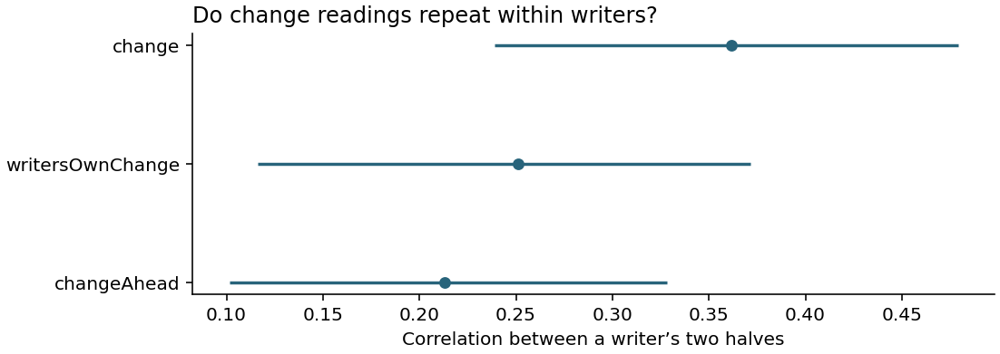

# Did the same writer repeatedly describe change in similar ways?

We compared each writer’s two halves after subtracting the average for the same assigned word among other writers.

Three split-half estimates filed.

| Share of sentences | Paired writers | Correlation (95% interval) |
|---|---:|---:|
| change | 336 | 0.3615 [0.2390, 0.4791] |
| writersOwnChange | 336 | 0.2510 [0.1160, 0.3715] |
| changeAhead | 336 | 0.2129 [0.1014, 0.3284] |

Descriptive single readings, outside the matching sets.

One reader’s sentence classifications on a single source.

[Aggregate E-TP39-CHANGE-20261121](../../../engine/validation/readers-writer-change-halves-2026-11.json)
