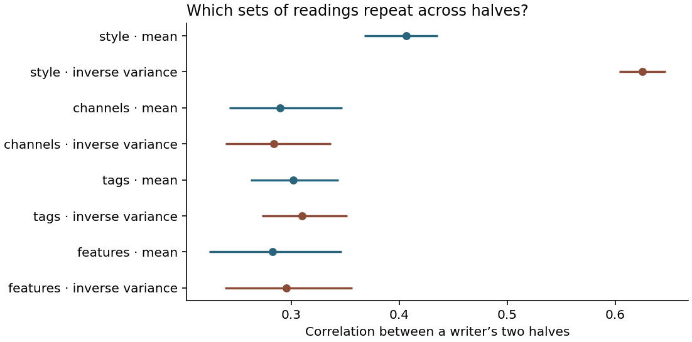

# Does the same writer leave a recognizable pattern after allowing for her assigned word?

We split 23,828 short situations from 336 writers in half and tried to match each writer with her other half among 168 candidates.

After allowing for the assigned feeling word, readings on the 19 tags repeated across halves. Writing style alone placed the correct writer in the first ten for 281 of 336 writers. Adding tags raised that count to 282. The paired 95% interval for the gain spanned −1.79 to +2.38 percentage points.

| Reading set | Mean split-half correlation (95% writer interval) | Inverse-variance mean (95% writer interval) |
|---|---:|---:|
| style | 0.4068 [0.3676, 0.4354] | 0.6253 [0.6035, 0.6463] |
| channels | 0.2901 [0.2426, 0.3474] | 0.2842 [0.2393, 0.3369] |
| tags | 0.3018 [0.2628, 0.3440] | 0.3102 [0.2727, 0.3521] |
| features | 0.2827 [0.2244, 0.3469] | 0.2955 [0.2385, 0.3564] |

The registered stability test gives each reading equal weight. The last column gives more weight to readings estimated more precisely. Both columns use the same writer resamples.

| Set | Likelihood first | Likelihood first ten | Distance first | Distance first ten |
|---|---:|---:|---:|---:|
| style | 0.6369 [0.5833, 0.6905] | 0.8363 [0.7976, 0.8751] | 0.4375 [0.3869, 0.4940] | 0.5982 [0.5475, 0.6488] |
| channels | 0.0506 [0.0298, 0.0744] | 0.3423 [0.2917, 0.3929] | 0.1488 [0.1131, 0.1875] | 0.3393 [0.2917, 0.3929] |
| tags | 0.1905 [0.1488, 0.2351] | 0.5357 [0.4851, 0.5893] | 0.2321 [0.1875, 0.2798] | 0.4613 [0.4077, 0.5149] |
| features | 0.0446 [0.0238, 0.0655] | 0.2530 [0.2083, 0.3006] | 0.0655 [0.0417, 0.0923] | 0.2619 [0.2143, 0.3125] |
| style+channels | 0.6369 [0.5863, 0.6905] | 0.8363 [0.7946, 0.8780] | 0.4405 [0.3899, 0.4940] | 0.5923 [0.5417, 0.6458] |
| style+tags | 0.6637 [0.6131, 0.7143] | 0.8393 [0.8006, 0.8780] | 0.4435 [0.3929, 0.4970] | 0.6161 [0.5625, 0.6667] |
| style+features | 0.6488 [0.5981, 0.7024] | 0.8423 [0.8036, 0.8810] | 0.4375 [0.3839, 0.4911] | 0.6250 [0.5714, 0.6756] |
| all | 0.6548 [0.6042, 0.7054] | 0.8452 [0.8065, 0.8839] | 0.4435 [0.3899, 0.4970] | 0.6042 [0.5536, 0.6577] |

First-ten gain adding tags to style: 0.0030 [-0.0179, 0.0238].
Chance within each 168-writer fold: first 0.0060, first ten 0.0595.

| Single reading | Paired writers | Split-half correlation (95% interval) |
|---|---:|---:|
| style/tokens | 336 | 0.9327 [0.9038, 0.9561] |
| style/meanWordLength | 336 | 0.5738 [0.4350, 0.6831] |
| style/form/i | 336 | 0.6133 [0.5115, 0.6961] |
| style/form/my | 336 | 0.5912 [0.4971, 0.6800] |
| style/form/a | 336 | 0.4380 [0.2983, 0.5625] |
| style/form/to | 336 | 0.2185 [0.0763, 0.3492] |
| style/form/the | 336 | 0.2367 [0.1051, 0.3658] |
| style/form/and | 336 | 0.6727 [0.5947, 0.7463] |
| style/form/was | 336 | 0.6433 [0.5213, 0.7439] |
| style/form/it | 336 | 0.4171 [0.3303, 0.5138] |
| style/form/in | 336 | 0.2163 [0.1013, 0.3342] |
| style/form/of | 336 | 0.1560 [0.0469, 0.2651] |
| style/form/for | 336 | 0.1687 [0.0090, 0.3324] |
| style/form/me | 336 | 0.2128 [0.0958, 0.3300] |
| style/form/so | 336 | 0.6570 [0.5480, 0.7554] |
| style/form/when | 336 | 0.7301 [0.5733, 0.8259] |
| style/form/on | 336 | 0.1051 [-0.0267, 0.2390] |
| style/form/that | 336 | 0.3628 [0.2394, 0.4847] |
| style/form/am | 336 | 0.7187 [0.5439, 0.8315] |
| style/form/had | 336 | 0.3089 [0.1941, 0.4343] |
| style/form/have | 336 | 0.5195 [0.0762, 0.7735] |
| style/form/at | 336 | 0.2515 [0.0902, 0.3996] |
| style/form/with | 336 | 0.1030 [-0.0331, 0.2532] |
| style/form/is | 336 | 0.3183 [0.1394, 0.4992] |
| style/form/out | 336 | 0.2747 [0.1397, 0.4048] |
| style/form/got | 336 | 0.2509 [0.0985, 0.4141] |
| style/form/really | 336 | 0.5243 [0.3449, 0.6664] |
| style/form/he | 336 | 0.3347 [0.1992, 0.4794] |
| style/form/i'm | 336 | 0.6622 [0.5152, 0.7807] |
| style/form/this | 336 | 0.5419 [0.2942, 0.7034] |
| style/form/but | 336 | 0.2785 [0.1375, 0.4176] |
| style/form/just | 336 | 0.3177 [0.2149, 0.4641] |
| style/form/up | 336 | 0.1347 [0.0081, 0.2651] |
| style/form/get | 336 | 0.1171 [-0.0013, 0.2924] |
| style/form/about | 336 | 0.1773 [0.0619, 0.3068] |
| style/form/her | 336 | 0.3065 [0.1918, 0.4208] |
| style/form/all | 336 | 0.0408 [-0.0643, 0.1486] |
| style/form/time | 336 | 0.4850 [0.1115, 0.7072] |
| style/form/she | 336 | 0.2691 [0.1221, 0.4315] |
| style/form/not | 336 | 0.3665 [0.2344, 0.4941] |
| style/form/be | 336 | 0.3768 [0.1114, 0.5977] |
| style/form/work | 336 | 0.2855 [0.1462, 0.4281] |
| style/form/going | 336 | 0.2865 [0.1045, 0.4612] |
| style/form/day | 336 | 0.4173 [0.1730, 0.6349] |
| style/form/last | 336 | 0.3265 [0.2127, 0.4435] |
| style/form/we | 336 | 0.4743 [0.3373, 0.5986] |
| style/form/been | 336 | 0.7652 [0.2292, 0.9102] |
| style/form/new | 336 | 0.2517 [0.1148, 0.3938] |
| style/form/friend | 336 | 0.3134 [0.1439, 0.5027] |
| style/form/one | 336 | 0.5014 [0.0918, 0.7493] |
| style/form/they | 336 | 0.1069 [0.0045, 0.2247] |
| style/form/from | 336 | 0.0527 [-0.0685, 0.1899] |
| style/comma | 336 | 0.7611 [0.6861, 0.8294] |
| style/fullStop | 336 | 0.8899 [0.8471, 0.9250] |
| style/exclamation | 336 | 0.7237 [0.6564, 0.8003] |
| style/questionMark | 336 | 0.2400 [-0.0047, 0.5856] |
| style/apostrophe | 336 | 0.7183 [0.6363, 0.7896] |
| style/capitalizedShare | 336 | 0.8571 [0.8006, 0.8998] |
| channels/SEEKING | 336 | 0.4062 [0.2854, 0.5506] |
| channels/PLAY | 336 | 0.3484 [0.1576, 0.5691] |
| channels/LUST | 336 | 0.3509 [0.2387, 0.4834] |
| channels/CARE | 336 | 0.3873 [0.2876, 0.5047] |
| channels/SADNESS | 336 | 0.2960 [0.1786, 0.4144] |
| channels/RAGE | 336 | 0.2433 [0.1120, 0.3760] |
| channels/FEAR | 336 | 0.2181 [0.0695, 0.3640] |
| channels/DISGUST | 336 | 0.1510 [0.0412, 0.2640] |
| channels/SHAME | 336 | 0.2097 [0.1134, 0.3235] |
| tags/contact | 336 | 0.2438 [0.1229, 0.3635] |
| tags/order | 336 | 0.2913 [0.1759, 0.4029] |
| tags/status | 336 | 0.2936 [0.1763, 0.4135] |
| tags/family | 336 | 0.4000 [0.2795, 0.5125] |
| tags/approval | 336 | 0.3214 [0.2272, 0.4157] |
| tags/curiosity | 336 | 0.1818 [0.0652, 0.3046] |
| tags/tranquility | 336 | 0.2460 [0.1196, 0.3762] |
| tags/competition | 336 | 0.3741 [0.2577, 0.4770] |
| tags/savings | 336 | 0.3767 [0.2512, 0.4862] |
| tags/indep | 336 | 0.2205 [0.0744, 0.3557] |
| tags/food | 336 | 0.4466 [0.3297, 0.5494] |
| tags/health | 336 | 0.2889 [0.1755, 0.4136] |
| tags/power | 336 | 0.1613 [0.0232, 0.3025] |
| tags/romance | 336 | 0.4535 [0.3239, 0.5710] |
| tags/honor | 336 | 0.3963 [0.2943, 0.4950] |
| tags/serenity | 336 | 0.3335 [0.2235, 0.4406] |
| tags/idealism | 336 | 0.2875 [0.1220, 0.4541] |
| tags/rest | 336 | 0.2582 [0.1010, 0.4291] |
| tags/belonging | 336 | 0.1593 [0.0660, 0.2775] |
| features/pleasantness | 336 | 0.2433 [0.1154, 0.3708] |
| features/unpleasantness | 336 | 0.3233 [0.1922, 0.4448] |
| features/self_responsblt | 336 | 0.2416 [0.1101, 0.3643] |
| features/goal_support | 336 | 0.2540 [0.1142, 0.3841] |
| features/social_norms | 336 | 0.0831 [-0.0360, 0.2055] |
| features/other_responsblt | 336 | 0.3515 [0.2300, 0.4721] |
| features/standards | 336 | 0.2508 [0.1241, 0.3709] |
| features/suddenness | 336 | 0.5141 [0.4056, 0.6120] |
| need/Competence | 336 | 0.1818 [0.0652, 0.3046] |
| need/Meaning | 336 | 0.3329 [0.2111, 0.4382] |
| need/Belonging (N3) | 336 | 0.2726 [0.1533, 0.3869] |
| need/Respect | 336 | 0.3071 [0.1915, 0.4198] |
| need/Compassion (N5) | 336 | 0.2875 [0.1220, 0.4541] |
| need/Body | 336 | 0.4129 [0.3065, 0.5217] |
| need/Belonging (N3+N5) | 336 | 0.2821 [0.1616, 0.4031] |
| worry | 278 | 0.4053 [0.2902, 0.5188] |

Mean tag correlation ≥.15 with its interval above zero. Paired first-ten gain above zero throughout its interval.

Within-file matching of short assigned situations. Circumstances or a common writing session may explain repetition. Worry covers only seven words.

[Aggregate E-TP39-20261121](../../../engine/validation/readers-writer-halves-2026-11.json)
