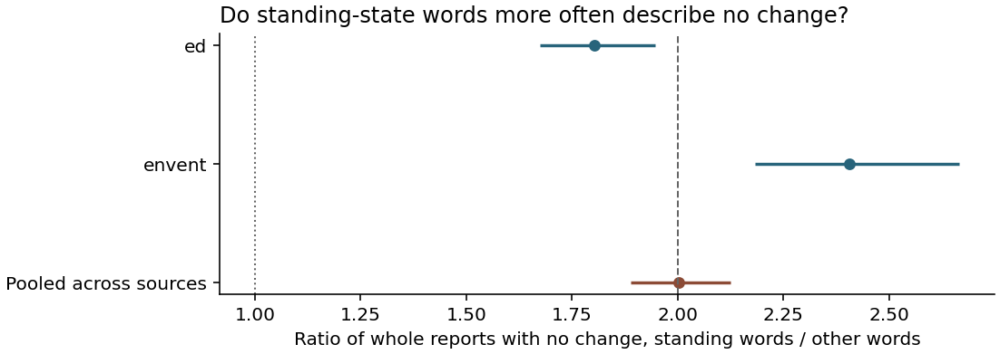

# Which feeling words tend to describe a situation that stays the same?

Two readers judged every sentence in 24,850 chat situations and 6,050 recalled events. One changed sentence counts as a change for the whole report.

Reader B misses the amended teaching check. The standing-state contrast does not clear both source thresholds.

| Source | Standing / other no-change rate ratio | Both bars met |
|---|---:|---|
| ed | 1.804 [1.673, 1.946] | False |
| envent | 2.406 [2.183, 2.666] | True |
| Pooled, inverse variance on log rate ratio | 2.003 [1.888, 2.126] | descriptive |

| Q11 source and words | Texts with change / texts | Sentences with change / sentences |
|---|---:|---:|
| ed / all | 1126/1500 | 1468/2500 |
| ed / other | 917/1166 | 1203/1939 |
| ed / standing | 209/334 | 265/561 |
| envent / all | 1181/1500 | 1406/2514 |
| envent / other | 1023/1230 | 1212/2043 |
| envent / standing | 158/270 | 194/471 |

| Source / feeling word | Texts | No-change texts | No-change sentences | B/W disagree on change |
|---|---:|---:|---:|---:|
| ed / afraid | 797 | 0.284 [0.236, 0.333] | 0.429 [0.390, 0.469] | 0.277 [0.247, 0.307] |
| ed / angry | 863 | 0.199 [0.158, 0.245] | 0.370 [0.325, 0.414] | 0.206 [0.177, 0.235] |
| ed / annoyed | 876 | 0.320 [0.275, 0.371] | 0.474 [0.434, 0.514] | 0.242 [0.213, 0.273] |
| ed / anticipating | 754 | 0.210 [0.162, 0.263] | 0.347 [0.310, 0.385] | 0.217 [0.188, 0.250] |
| ed / anxious | 774 | 0.279 [0.238, 0.324] | 0.430 [0.396, 0.464] | 0.253 [0.226, 0.282] |
| ed / apprehensive | 608 | 0.316 [0.270, 0.359] | 0.472 [0.434, 0.508] | 0.240 [0.215, 0.266] |
| ed / ashamed | 628 | 0.154 [0.118, 0.191] | 0.323 [0.291, 0.357] | 0.276 [0.246, 0.306] |
| ed / caring | 683 | 0.365 [0.285, 0.451] | 0.458 [0.400, 0.522] | 0.140 [0.113, 0.168] |
| ed / confident | 785 | 0.243 [0.201, 0.292] | 0.384 [0.349, 0.423] | 0.209 [0.178, 0.239] |
| ed / content | 737 | 0.383 [0.327, 0.441] | 0.538 [0.499, 0.579] | 0.212 [0.182, 0.242] |
| ed / devastated | 712 | 0.022 [0.013, 0.035] | 0.200 [0.172, 0.228] | 0.151 [0.124, 0.176] |
| ed / disappointed | 770 | 0.113 [0.083, 0.147] | 0.286 [0.253, 0.323] | 0.256 [0.227, 0.286] |
| ed / disgusted | 787 | 0.277 [0.236, 0.323] | 0.482 [0.446, 0.516] | 0.225 [0.202, 0.251] |
| ed / embarrassed | 740 | 0.119 [0.095, 0.146] | 0.319 [0.287, 0.352] | 0.291 [0.260, 0.320] |
| ed / excited | 938 | 0.167 [0.121, 0.223] | 0.317 [0.280, 0.355] | 0.168 [0.144, 0.196] |
| ed / faithful | 478 | 0.510 [0.447, 0.582] | 0.596 [0.547, 0.646] | 0.172 [0.143, 0.201] |
| ed / furious | 759 | 0.130 [0.099, 0.169] | 0.322 [0.282, 0.363] | 0.184 [0.154, 0.214] |
| ed / grateful | 815 | 0.280 [0.232, 0.330] | 0.414 [0.376, 0.450] | 0.141 [0.121, 0.162] |
| ed / guilty | 760 | 0.162 [0.129, 0.197] | 0.335 [0.296, 0.370] | 0.250 [0.219, 0.283] |
| ed / hopeful | 781 | 0.206 [0.161, 0.256] | 0.334 [0.299, 0.368] | 0.200 [0.177, 0.224] |
| ed / impressed | 805 | 0.323 [0.271, 0.378] | 0.487 [0.444, 0.531] | 0.161 [0.141, 0.183] |
| ed / jealous | 757 | 0.328 [0.272, 0.391] | 0.500 [0.462, 0.539] | 0.134 [0.111, 0.158] |
| ed / joyful | 770 | 0.201 [0.160, 0.244] | 0.358 [0.327, 0.393] | 0.161 [0.136, 0.184] |
| ed / lonely | 814 | 0.195 [0.159, 0.237] | 0.344 [0.306, 0.386] | 0.235 [0.205, 0.263] |
| ed / nostalgic | 759 | 0.607 [0.559, 0.657] | 0.708 [0.671, 0.743] | 0.187 [0.161, 0.214] |
| ed / prepared | 766 | 0.307 [0.251, 0.365] | 0.420 [0.381, 0.462] | 0.257 [0.221, 0.293] |
| ed / proud | 867 | 0.138 [0.105, 0.177] | 0.303 [0.267, 0.339] | 0.131 [0.110, 0.154] |
| ed / sad | 857 | 0.102 [0.076, 0.128] | 0.275 [0.238, 0.312] | 0.178 [0.155, 0.201] |
| ed / sentimental | 698 | 0.481 [0.427, 0.545] | 0.613 [0.575, 0.655] | 0.177 [0.149, 0.204] |
| ed / surprised | 1279 | 0.101 [0.079, 0.122] | 0.256 [0.233, 0.278] | 0.222 [0.196, 0.245] |
| ed / terrified | 782 | 0.266 [0.211, 0.324] | 0.427 [0.391, 0.463] | 0.257 [0.227, 0.288] |
| ed / trusting | 651 | 0.338 [0.283, 0.399] | 0.479 [0.438, 0.522] | 0.217 [0.178, 0.264] |
| ed / standing | 5688 | 0.374 [0.344, 0.406] | 0.503 [0.483, 0.525] | 0.211 [0.196, 0.226] |
| ed / other | 19162 | 0.207 [0.184, 0.233] | 0.368 [0.348, 0.387] | 0.206 [0.196, 0.218] |
| envent / anger | 550 | 0.209 [0.175, 0.244] | 0.401 [0.364, 0.439] | 0.242 [0.215, 0.271] |
| envent / boredom | 550 | 0.520 [0.478, 0.564] | 0.653 [0.618, 0.687] | 0.207 [0.180, 0.236] |
| envent / disgust | 550 | 0.338 [0.296, 0.381] | 0.539 [0.502, 0.573] | 0.218 [0.192, 0.246] |
| envent / fear | 550 | 0.224 [0.189, 0.259] | 0.465 [0.430, 0.499] | 0.181 [0.159, 0.204] |
| envent / guilt | 275 | 0.189 [0.142, 0.235] | 0.429 [0.382, 0.475] | 0.224 [0.191, 0.262] |
| envent / joy | 550 | 0.229 [0.192, 0.268] | 0.476 [0.436, 0.511] | 0.137 [0.116, 0.159] |
| envent / pride | 550 | 0.149 [0.120, 0.182] | 0.381 [0.341, 0.416] | 0.115 [0.094, 0.136] |
| envent / relief | 550 | 0.089 [0.065, 0.114] | 0.344 [0.312, 0.378] | 0.136 [0.116, 0.159] |
| envent / sadness | 550 | 0.084 [0.060, 0.108] | 0.341 [0.307, 0.374] | 0.139 [0.117, 0.160] |
| envent / shame | 275 | 0.160 [0.117, 0.204] | 0.406 [0.358, 0.452] | 0.221 [0.184, 0.256] |
| envent / surprise | 550 | 0.078 [0.056, 0.102] | 0.355 [0.322, 0.387] | 0.120 [0.099, 0.141] |
| envent / trust | 550 | 0.322 [0.282, 0.364] | 0.564 [0.532, 0.598] | 0.176 [0.154, 0.199] |
| envent / standing | 1100 | 0.421 [0.390, 0.451] | 0.607 [0.583, 0.631] | 0.191 [0.174, 0.210] |
| envent / other | 4950 | 0.175 [0.162, 0.188] | 0.414 [0.399, 0.429] | 0.168 [0.159, 0.176] |

Standing words have at least twice the no-change rate in each source, with the interval above one. Q11 separately requires 85% change on other words in each source.

The benchmark measures a model’s definition of change. The words were fixed after the earlier sentence-level miss and before the word breakdown.

[Aggregate E-TP40-20261121](../../../engine/validation/readers-change-by-word-2026-11.json)
