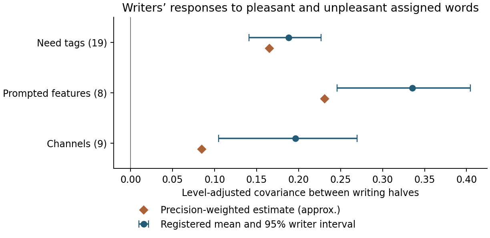

# Does each writer change her need readings differently between kinds of assigned words?

We compared pleasant and unpleasant assigned situations in both halves of 270 writers’ texts.

Lands. Mean adjusted tag covariance 0.1879 [0.1409, 0.2269]. A quarter of tag level covariance was 0.0554.

| Reading or set | Adjusted contrast covariance [95% interval] | Level covariance [95% interval] |
|---|---:|---:|
| tags | 0.1879 [0.1409, 0.2269] | 0.2216 [0.1951, 0.2428] |
| features | 0.3354 [0.2458, 0.4043] | 0.1623 [0.1331, 0.1898] |
| channels | 0.1960 [0.1048, 0.2695] | 0.2452 [0.1768, 0.3308] |
| tags/contact | 0.2416 [0.0982, 0.4031] | 0.2381 [0.1608, 0.3133] |
| tags/order | 0.1558 [0.0455, 0.2606] | 0.2204 [0.1545, 0.2837] |
| tags/status | 0.2106 [0.0888, 0.3338] | 0.2101 [0.1461, 0.2742] |
| tags/family | 0.1427 [0.0725, 0.2089] | 0.3228 [0.2417, 0.4120] |
| tags/approval | 0.1885 [0.0867, 0.2891] | 0.2311 [0.1601, 0.3055] |
| tags/curiosity | 0.3175 [0.1623, 0.4717] | 0.1756 [0.1216, 0.2261] |
| tags/tranquility | 0.2243 [0.0832, 0.3655] | 0.1899 [0.1282, 0.2508] |
| tags/competition | 0.1727 [0.0787, 0.2691] | 0.3098 [0.2352, 0.3833] |
| tags/savings | 0.0576 [-0.0277, 0.1442] | 0.2274 [0.1710, 0.2824] |
| tags/indep | 0.2475 [0.1326, 0.3631] | 0.2159 [0.1579, 0.2841] |
| tags/food | 0.1504 [0.0336, 0.2373] | 0.3211 [0.2139, 0.4350] |
| tags/health | 0.2678 [0.1309, 0.3945] | 0.1994 [0.1440, 0.2551] |
| tags/power | 0.2304 [0.1128, 0.3324] | 0.1986 [0.1353, 0.2593] |
| tags/romance | 0.1377 [0.0514, 0.2258] | 0.2451 [0.1828, 0.3067] |
| tags/honor | 0.1604 [0.0720, 0.2484] | 0.2545 [0.1764, 0.3308] |
| tags/serenity | 0.2250 [0.1051, 0.3343] | 0.2080 [0.1189, 0.3214] |
| tags/idealism | 0.1371 [0.0574, 0.2165] | 0.1640 [0.1079, 0.2205] |
| tags/rest | 0.2269 [0.1014, 0.3494] | 0.1630 [0.1069, 0.2289] |
| tags/belonging | 0.0764 [-0.0053, 0.1511] | 0.1158 [0.0546, 0.2007] |
| features/pleasantness | 0.6514 [0.4385, 0.8147] | 0.1207 [0.0772, 0.1675] |
| features/unpleasantness | 0.4576 [0.2700, 0.6166] | 0.1544 [0.1049, 0.2109] |
| features/self_responsblt | 0.2438 [0.0904, 0.3961] | 0.1447 [0.0920, 0.1982] |
| features/goal_support | 0.5061 [0.3041, 0.6921] | 0.0866 [0.0541, 0.1200] |
| features/social_norms | 0.0685 [-0.0190, 0.1461] | 0.0762 [0.0307, 0.1160] |
| features/other_responsblt | 0.2740 [0.1336, 0.4100] | 0.2058 [0.1470, 0.2659] |
| features/standards | 0.3286 [0.1804, 0.4512] | 0.1735 [0.1006, 0.2403] |
| features/suddenness | 0.1535 [0.0707, 0.2392] | 0.3367 [0.2421, 0.4284] |
| channels/SEEKING | 0.1910 [0.0585, 0.3425] | 0.3382 [0.2384, 0.4446] |
| channels/PLAY | 0.0670 [-0.1206, 0.2318] | 0.1096 [0.0589, 0.1771] |
| channels/LUST | 0.6113 [0.0781, 1.1900] | 0.6662 [0.1941, 1.4152] |
| channels/CARE | 0.1308 [0.0497, 0.2204] | 0.4075 [0.2988, 0.5143] |
| channels/SADNESS | 0.1852 [0.0861, 0.2691] | 0.1541 [0.0808, 0.2465] |
| channels/RAGE | 0.1386 [0.0609, 0.1960] | 0.1144 [0.0785, 0.1495] |
| channels/FEAR | 0.1790 [0.0829, 0.2674] | 0.1551 [0.0914, 0.2235] |
| channels/DISGUST | 0.0414 [0.0119, 0.0654] | 0.1623 [0.0856, 0.2599] |
| channels/SHAME | 0.2200 [0.1135, 0.3225] | 0.0999 [0.0656, 0.1344] |

Mean level-adjusted tag covariance with interval above zero. If missed, compare the upper end to a quarter of tag level covariance.

Short situations written to assigned words. Both halves may come from one sitting.

[Aggregate E-TP41-20261121](../../../engine/validation/readers-tp41-2026-11.json)

Circles show equal-weight means and paired writer intervals. Diamonds weight the individual readings by inverse squared interval width as an approximation to inverse variance.
