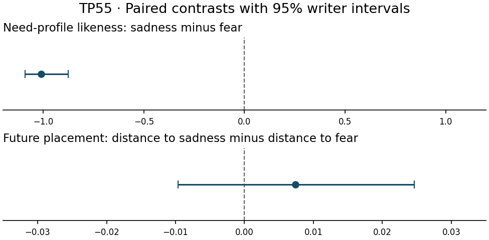

# TP55 · Anxiety as a loss ahead

In 24,850 chat situations, 810 writers described an experience for an assigned feeling word. We compared the average 19-tag profile for *anxious* and *apprehensive* with the sad and fear groups. We also compared how often reader B marked a sentence as looking ahead.

| Registered contrast | Estimate | 95% writer interval | Bar | Verdict |
|---|---:|---:|---|---|
| ○ × Likeness to sadness less likeness to fear | −1.011 | [−1.092, −0.877] | Interval above zero | Miss, opposite direction |
| ○ Distance in time to sadness less distance to fear | +0.0074 | [−0.0096, +0.0246] | Interval above zero | Miss, direction unresolved |

○ denotes a preregistered positive direction. × marks a clear departure. The first contrast is a difference of correlations. The second is a difference of sentence shares. Each interval uses 2,000 whole-writer draws with the 32-word reference profile recalculated.

The anxious pair’s profile correlated −0.580 with the sad group and +0.432 with the fear group. Reader B marked 21.6% of sentences ahead for the anxious pair, 7.1% for sadness and 7.8% for fear, giving each word equal weight within its group. The analyst guessed that the profile row would pass and the time row would miss. Only the second guess held.

The words were assigned. *Apprehensive* and *afraid* are close in meaning. These results concern the descriptions people wrote and the judgments reader B made about their sentences. ED is research-only. [Source-bound aggregate and word denominators](../../../engine/validation/readers-tp55-2026-11.json).
